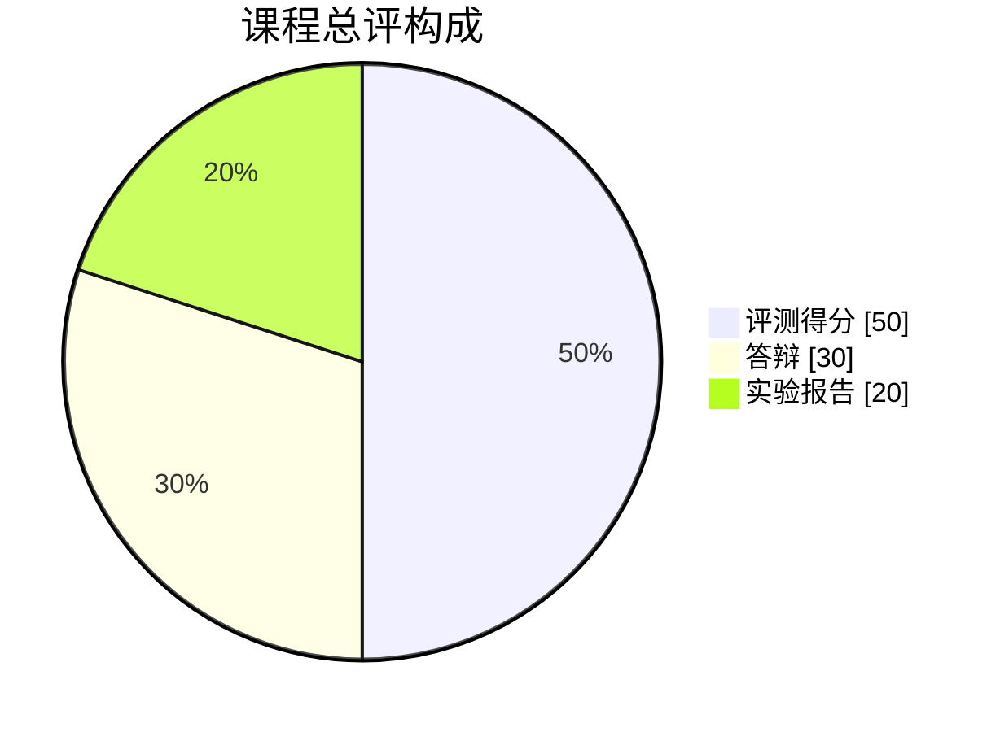

# 评分标准

## 一、总评构成

本课程最终成绩由评测得分、答辩得分和实验报告得分三部分构成：

| 组成部分 | 占比 |
| --- | ---: |
| 评测得分 | 50% |
| 答辩得分 | 30% |
| 实验报告得分 | 20% |

## 二、评测得分：50%

评测得分由希冀平台自动计算，分为功能评测和性能评测两部分：

| 项目 | 权重 | 说明 |
| --- | ---: | --- |
| 功能评测 | 42.5% | 检查生成的 RV64GC 程序的运行结果 |
| 性能评测 | 7.5% | 按整体加速比分档计分，检查优化效果 |

表中 42.5% 与 7.5% 是总评占比；评测部分内部按功能 85%、性能 15% 合成。

:::info[计分说明]
词法分析、语法分析以及选做语义分析只用于检查输入能否正确进入后端，**不单独计分**。评测重点是目标代码生成和优化部分。
:::

### 性能分档

性能基准固定为 **GCC `-O2`**，比较其生成程序与学生编译器在 `-asm -opt` 下生成程序的运行时间。GCC 版本、目标架构、测试集、运行环境和超时限制由课程组统一公布。

单例加速比为“基准耗时 ÷ 学生程序耗时”，整体加速比 **S** 取全部性能用例加速比的几何平均值，各用例权重相同；S 越大表示整体运行越快。例如，两例加速比分别为 2 和 0.5，整体加速比为 1。

性能用例须全部结果正确且在时限内完成，方可参与分档；出现错误、崩溃或超时，性能项计 0 分，功能项仍按功能评测结果计分。

| 整体加速比 S | 性能项得分比例 | 折合总评得分（满分 7.5 分） |
| --- | ---: | ---: |
| 0 ＜ S ＜ 0.15 | 40% | 3.00 |
| 0.15 ≤ S  0.30 | 60% | 4.50 |
| 0.30 ≤ S ＜ 0.50 | 70% | 5.25 |
| 0.50 ≤ S ＜ 0.70 | 80% | 6.00 |
| 0.70 ≤ S ＜ 0.80 | 90% | 6.75 |
| S ≥ 0.80 | 100% | 7.50 |

正确完成全部性能用例可获得性能项的及格分，较高得分须达到相应速度门槛；整体达到 GCC `-O2` 70% 的速度可得 90%，达到基准速度 80% 可得满分。相邻档位相差 10 个百分点，在区分优化效果的同时控制分差。分档比例乘以 7.5 即为计入总评的性能分，总评汇总后保留两位小数。

## 三、答辩得分：30%

第 12 周和第 17 周各检查一次。每组自述 10 分钟、提问 10 分钟，每次共 20–30 分钟。答辩主要考察代码原理、实现方法和实验结果，范围见[验收方式](./workflow#四验收方式)。

- **小组介绍**：说明实验完成情况、阶段分工与个人贡献、合作中遇到的问题及解决思路，以及 AI 使用情况。
- **全员回答**：每位成员均须回答实验相关问题，独立说明代码、算法和文字的原理、逻辑、实现过程及本人贡献。使用框架也须解释原理，不得以“框架自带”回避；无法解释者扣除对应部分分数。

## 四、实验报告得分：20%

**实验报告不是越长越好。** 评分重在内容正确、表达清楚，能说明做了什么、为什么这样设计、关键步骤如何实现，以及结果说明了什么；字数和页数不作为加分依据。避免重复叙述、照搬教材或堆砌大段源码。

可以结合文字与图表表达：用流程图说明算法步骤，用结构图说明模块关系，用表格比较方案或评测结果。图表应有必要的标注，并配合简短文字说明其含义与结论，帮助读者理解实现。

实验报告由助教人工批改，主要考察以下方面：

| 评分要点 | 说明 |
| --- | --- |
| 实验原理 | 是否正确描述涉及的编译理论 |
| 设计思路 | 架构设计、模块划分是否合理 |
| 关键算法 | 算法描述是否清晰 |
| 表达与组织 | 重点是否明确、叙述是否简洁，文字与图表能否清楚说明设计和实现 |
| 评测结果分析 | 是否结合平台评测结果分析正确性与性能 |
| 分工说明 | 阶段分工、个人贡献与团队合作情况是否清楚 |
| AI 使用情况 | 是否单列说明工具名称、使用范围、验证方法及本人补充或修改的内容 |
| 问题与心得 | 遇到的问题记录和解决思路 |

