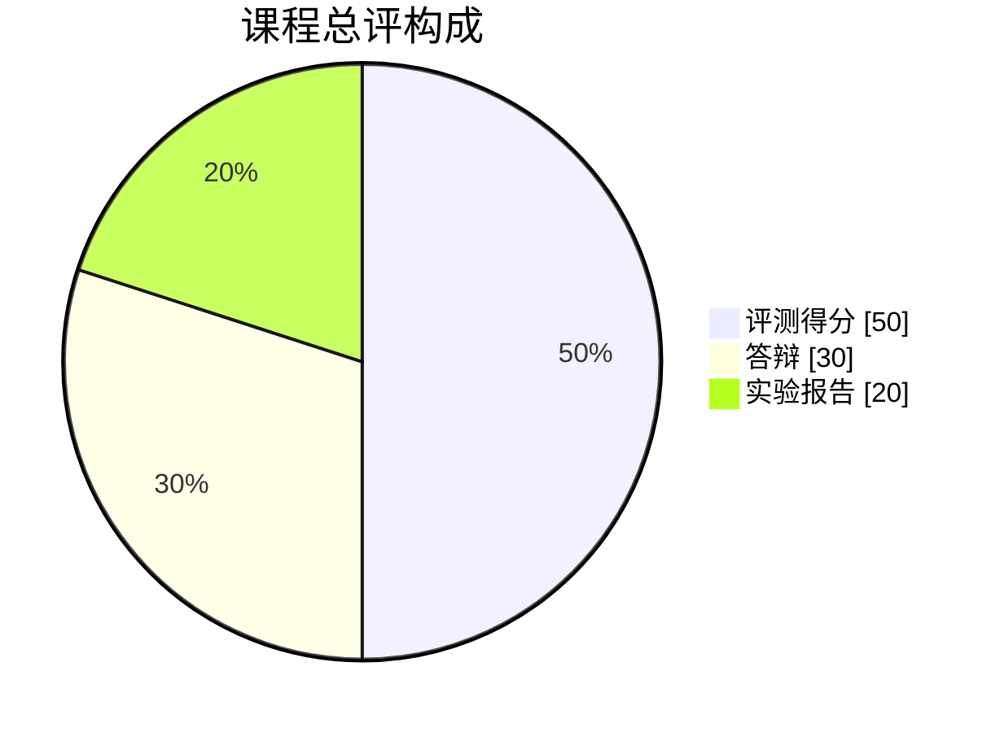

# 评分标准

## 一、总评构成

本课程最终成绩由评测得分、答辩得分和实验报告得分三部分构成：

| 组成部分 | 占比 |
| --- | ---: |
| 评测得分 | 50% |
| 答辩得分 | 30% |
| 实验报告得分 | 20% |

## 二、评测得分：50%

评测得分由希冀平台自动计算，分为功能评测和性能评测两部分：

| 项目 | 权重 | 说明 |
| --- | ---: | --- |
| 功能评测 | 42.5% | 检查生成的 RV64GC 程序的运行结果 |
| 性能评测 | 7.5% | 比较生成代码的运行时间，检查优化效果 |

表中 42.5% 与 7.5% 是总评占比；评测部分内部按功能 85%、性能 15% 合成。

:::info[计分说明]
词法分析、语法分析以及选做语义分析只用于检查输入能否正确进入后端，**不单独计分**。评测重点是目标代码生成和优化部分。
:::

## 三、答辩得分：30%

第 12 周和第 17 周各检查一次。每组自述 10 分钟、提问 10 分钟，每次共 20–30 分钟。答辩主要考察代码原理、实现方法和实验结果，范围见[验收方式](./workflow#四验收方式)。

## 四、实验报告得分：20%

**实验报告不是越长越好。** 评分重在内容正确、表达清楚，能说明做了什么、为什么这样设计、关键步骤如何实现，以及结果说明了什么；字数和页数不作为加分依据。避免重复叙述、照搬教材或堆砌大段源码。

可以结合文字与图表表达：用流程图说明算法步骤，用结构图说明模块关系，用表格比较方案或评测结果。图表应有必要的标注，并配合简短文字说明其含义与结论，帮助读者理解实现。

实验报告由助教人工批改，主要考察以下方面：

| 评分要点 | 说明 |
| --- | --- |
| 实验原理 | 是否正确描述涉及的编译理论 |
| 设计思路 | 架构设计、模块划分是否合理 |
| 关键算法 | 算法描述是否清晰 |
| 表达与组织 | 重点是否明确、叙述是否简洁，文字与图表能否清楚说明设计和实现 |
| 评测结果分析 | 是否结合平台评测结果分析正确性与性能 |
| 分工说明 | 团队合作水平 |
| 问题与心得 | 遇到的问题记录和解决思路 |

