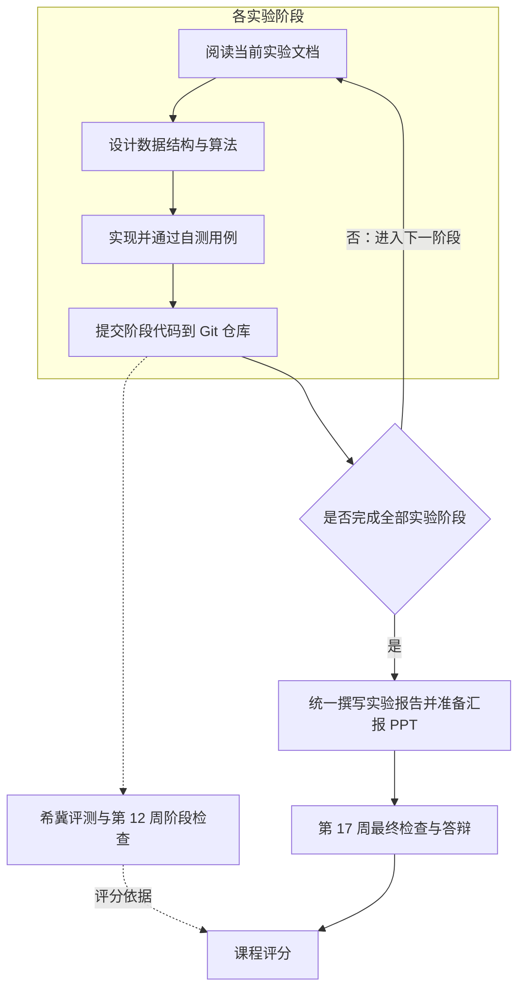

import {CompilerPipeline} from '@site/src/components/CourseMap';

# 实验流程与代码规范

## 一、总体流程

### 实验推进



各阶段完成设计、实现、自测和代码提交。全部实验完成后，每组提交一份报告，按实验部分组织内容。助教检查用于评分，不影响后续实验进度。

### 编译器处理顺序

实验按编号依次完成；编译器运行时，第三部分生成的 IR 可先经过第五部分优化，再交给第四部分生成汇编，第六部分随后优化目标代码。第四部分完成后即可链接运行时库，得到可运行的基线程序。

<CompilerPipeline />

## 二、提交规范

### 分支模型

- `main`：只接受合并，不直接开发；
- `partN`：每个实验部分一个分支，例如 `part1-lexer`；
- 提交信息使用如下格式：

```text
<part>: <简述>

例：
part1: 实现标识符与数字常量的扫描
part1: 修复注释跨行时的状态回退缺陷
```

提交内容与禁止事项见[希冀提交与评测](./submission)。

## 三、代码规范

### 命名与注释

按语言选择对应的命名规则，同一项目内必须保持一致：

- **类型名**：使用 PascalCase，如 `Token`、`BasicBlock`、`LiveInterval`；
- **C / C++ / Rust 函数与变量**：使用 snake_case，如 `next_token`、`current_line`；
- **Java 函数与变量**：使用 camelCase，如 `nextToken`、`currentLine`；
- **常量**：使用 UPPER_SNAKE_CASE，如 `MAX_TOKEN_LEN`、`EOF`。

示例：

```cpp
// C/C++ / Rust 风格
struct Token {                  // 类型名 PascalCase
  TokenType type;               // 变量名 snake_case
  std::string lexeme;
  int line_no;
};

Token next_token();             // 函数名 snake_case
static constexpr int MAX_LEN = 64;  // 常量 UPPER_SNAKE_CASE

// Java 风格
class Token {                   // 类型名 PascalCase
  TokenType type;               // 变量名 camelCase
  String lexeme;
  int lineNo;
}

Token nextToken();              // 函数名 camelCase
static final int MAX_LEN = 64;  // 常量 UPPER_SNAKE_CASE
```

子集构造、FIRST/FOLLOW 计算、活变量分析等关键算法应说明实现逻辑；复现已有算法时注明出处。

### 错误处理

编译器遇到错误输入时，应输出错误位置和原因，并以非零状态退出。诊断信息写入 stderr，正常结果写入 stdout。

### 统一驱动接口

统一驱动必须支持以下参数，名称须与表中一致。编译器从标准输入读取 ToyC 源程序、向标准输出写入阶段结果，不要在程序中固定打开 `input.c` 或 `output.s` 等文件。

| 参数 | 作用 | 详细规范 |
| --- | --- | --- |
| `-token` | 输出 Token 流 | [第一部分：输入输出规范](../labs/part1-lexer#五输入输出规范与统一样例) |
| `-ast` | 检查语法及已实现的选做语义分析，输出 `accept` / `reject` 及错误行号 | [语法规范](../labs/part2-parser#六输入输出规范与统一样例)、[语义规范](../labs/optional-semantic#五输入输出规范与统一样例) |
| `-asm` | 输出 RV64GC 汇编 | [第四部分：输入输出规范](../labs/part4-codegen#六输入输出规范与统一样例) |
| `-opt` | 与 `-asm` 组合，启用已实现的优化 | [中间代码优化](../labs/part5-ir-optimization)、[目标代码优化](../labs/part6-target-optimization) |

自测时用重定向保存结果，文件类型与命名见[测试文件命名约定](./submission#测试文件命名约定)：

```bash
# 执行位置：WSL / Ubuntu 开发主机终端，编译器项目根目录
./compiler -token   < input.c > input.token      # 第一部分：Token 流
./compiler -ast     < input.c > input.check-ast  # 语法与选做语义检查，输出 accept / reject
./compiler -asm     < input.c > input.s          # 功能样例：不带 -opt
./compiler -asm -opt < input.c > input.opt.s     # 性能样例：启用优化
```

功能样例不传入 `-opt`，必须保证功能正确；性能样例使用 `-asm -opt` 组合调用。暂未实现优化时也必须静默接受 `-opt`，输出正常汇编，不得向标准输出写入额外提示。是否实现优化不影响基础正确性判定，最终评测重点是汇编及其运行结果。

语义分析与语法分析共用一次提交和 `-ast` 调用。先检查语法，语法通过后执行已实现的语义检查；检查结果写入同一个 `.check-ast` 文件，不输出 AST 或符号表。

`-ir` 不是必要接口，评测脚本不会调用。若实现了本地 IR 调试输出，可使用以下组合观察中间结果：

```bash
# 执行位置：WSL / Ubuntu 开发主机终端，编译器项目根目录
./compiler -ir < input.c > input.ll          # 可选：LLVM IR
./compiler -ir -opt < input.c > input.opt.ll  # 可选：优化后的 LLVM IR
```

## 四、验收方式

提交前请阅读[希冀提交与评测](./submission)。平台自动检查编译器的正确性与性能，助教根据阶段产物提问。同学们需要说明所提交代码的实现原理、数据结构和算法；使用自动化编程工具时也应能够解释相关代码。

- **自动测试**：使用统一测试集运行编译器并比较输出；
- **汇报展示与提问**：说明编译器架构、阶段产物和关键实现；
- **助教检查**：检查符号表、活跃变量、寄存器分配等实现，作为评分依据。

### 两次检查安排

| 周次 | 检查内容 | 每组每次时长 |
| --- | --- | --- |
| 第 12 周 | 阶段实现、关键数据结构与当前产出 | 学生自述 10 分钟 + 提问 10 分钟，总共 20–30 分钟 |
| 第 17 周 | 完整编译器、优化效果与最终材料 | 学生自述 10 分钟 + 提问 10 分钟，总共 20–30 分钟 |

答辩占 30%，平台评测占 50%，实验报告占 20%，见[评分标准](./grading)。

### 助教提问范围

提问围绕所提交代码的原理与实现，主要包括：

| 部分 | 需要说明的内容 |
| --- | --- |
| 词法分析 | 状态机设计、Token 分类依据与错误恢复 |
| 语法分析 | 文法改写、FIRST/FOLLOW 集、分析方法的取舍与冲突处理 |
| 选做语义分析 | 符号表、作用域、类型与控制流检查 |
| IR 与 SSA | 数据结构、SSA 构造、支配边界与 phi 节点 |
| 中间代码优化 | 各项优化的算法、数据流方程与不动点计算 |
| 目标代码生成 | 指令选择、调用约定、栈帧布局与寄存器保存 |
| 寄存器分配 | 活跃变量、线性扫描或图着色、spill 策略 |
| 目标代码优化 | 窥孔优化、寄存器复用与分支优化 |

范围不限于表中内容，同学们应能结合自己的实现解释设计取舍和调试过程。

## 五、时间安排

### 建议课时

| 实验部分 | 核心产出 | 建议课时 |
| --- | --- | ---: |
| 一、词法分析 | Token 流 | 8 |
| 二、语法分析 | AST 与分析器 | 12 |
| 三、中间代码生成 | IR 设计与转换方案 | 10 |
| 四、目标代码生成 | 基线 RISC-V64GC 汇编 | 12 |
| 五、中间代码优化 | 优化后的 IR | 9 |
| 六、目标代码优化 | 优化后的 RISC-V 汇编 | 9 |
| **合计** | | **60** |

### 阶段里程碑

| 周次 | 里程碑 | 交付 |
| --- | --- | --- |
| 第 10 周 | 完成词法分析 | 词法分析器与 Token 流 |
| 第 11 周 | 完成语法分析 | 语法分析器与 AST |
| 第 12 周 | 完成中间代码表示，第一次检查 | IR 设计、AST 到 IR 的转换方案与阶段自述 |
| 第 13–14 周 | 完成目标代码生成和优化 | 可运行的 RISC-V64GC 汇编与优化验证结果 |
| 第 15–16 周 | 集成测试与完善材料 | 功能与性能评测结果、报告与 PPT 草稿 |
| 第 17 周 | 第二次检查与最终答辩 | 统一实验报告、汇报 PPT 与实验结果说明 |
