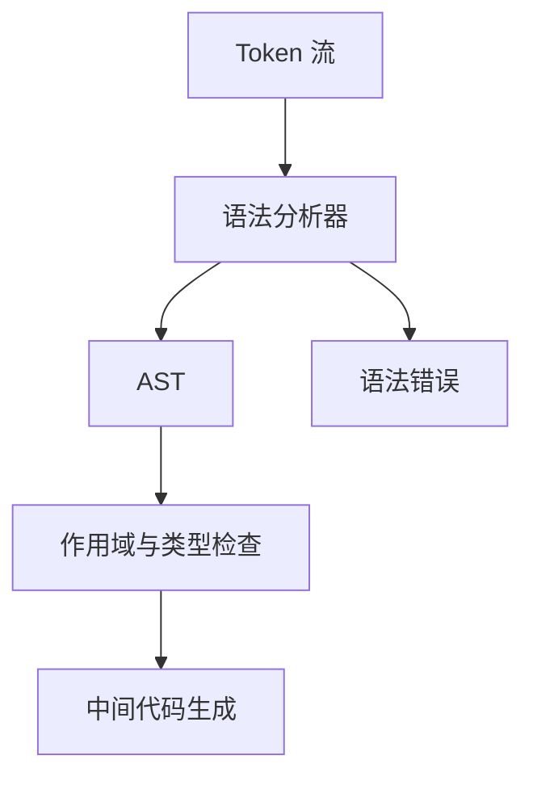
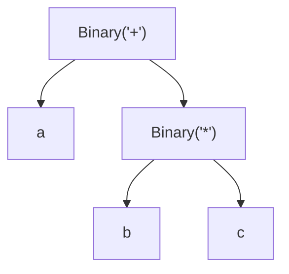
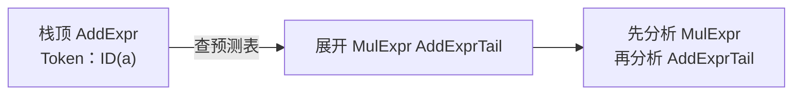
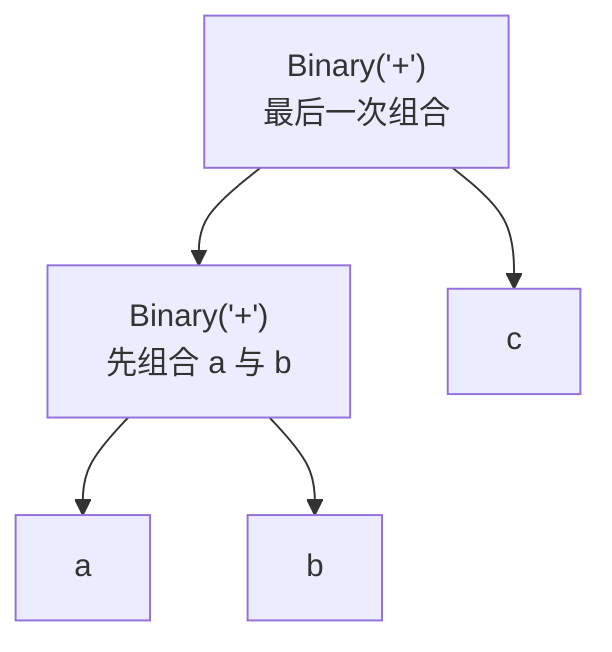
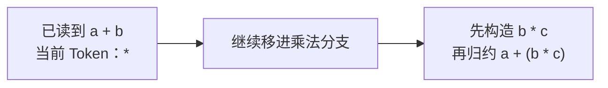

import ToyCGrammar from '@site/src/components/ToyCGrammar';

# 第二部分 · 语法分析

## 一、实验目标

语法分析器（parser）读取第一部分产出的 Token 流，检查它是否符合 ToyC 文法，并构造出后续语义分析和 IR 生成要用的抽象语法树（AST）。

:::info[基本原理]
语法分析依据文法将 Token 流组织为抽象语法树；树的层次结构表示运算符的优先级、结合性和程序结构。
:::



### 本部分的三条可选技术路线

本部分允许任选一条路线实现，但必须在报告中说明取舍理由：

| 路线 | 基本思路 | 实现难度 | 说明 |
| --- | --- | --- | --- |
| 递归下降 | 每个非终结符对应一个函数 | 低 | 先把左递归改写为右递归，再编写分析函数 |
| LL(1) | 预测分析表 + 显式栈 | 中 | 先把左递归改写为右递归并提取左公因子，再计算 FIRST / FOLLOW |
| LR(0) / SLR(1) | 项目集 + ACTION/GOTO 表 | 高 | 可保留左递归，自底向上归约；需要检查表冲突 |

三条路线的输入、输出和语言约定相同：都读取第一部分的 Token 流并生成同一套 AST。选择递归下降或 LL(1) 时，同学们必须先将不能直接处理的左递归产生式等价改写为右递归形式，再实现分析算法；LL(1) 还需要提取左公因子并检查预测表冲突。若选择 LR，则可保留左递归，并在报告中说明冲突处理和归约动作。

## 二、ToyC 核心文法

本部分使用[词法与文法约定](../reference/grammar)中的 ToyC 文法。
下面使用 EBNF 记号：`[ ... ]` 表示可选，`*` 表示重复零次或多次，`+` 表示重复一次或多次，`|` 表示选择；单引号中的内容是终结符。

<ToyCGrammar />

ToyC 没有全局变量，`CompUnit` 只展开为函数定义。`getint`、`putint` 按普通 `ID` 和函数调用解析，不为库函数增加特殊产生式。

## 三、从 Token 到 AST 的转换逻辑

三条路线都要把 Token 组织成 AST，但驱动方式不同：递归下降由函数调用推进，LL(1) 根据栈顶和向前看 Token 查预测表，LR 根据状态栈查 ACTION/GOTO 表。AST 不保留没有语义的括号和分号，但保留源位置，用于后续报错。

### 先读懂示例中的符号

| 写法 | 含义 |
| --- | --- |
| `ID`、`'+'` | 终结符，即 Token 类型；单引号标出具体关键字或符号 |
| `ID(a)` | 类型为 `ID`、源文本为 `a` 的一个 Token |
| `AddExpr`、`MulExpr` | 非终结符，分别表示加减表达式、乘除表达式 |
| `A -> α` | 产生式；`A` 是非终结符，`α`、`β`、`γ` 代表一串文法符号 |
| `ε` | 空串：此分支不匹配任何 Token |
| `∈`、`∪`、`∅` | 分别表示“属于某集合”、集合的并集、空集合 |
| `$` | 整个输入的结束标记，由分析器补充；分号 `;` 只是语句中的 Token |
| `Variable('a')`、`Binary(op, left, right)` | AST 节点：变量，以及带两个子节点的二元运算；构造节点不执行运算 |
| `…` | 为节省空间省略的外层栈内容，当前示例不改变它 |

下面的步骤表均展示**执行本步动作之前**的栈、调用位置或未读输入；动作执行后的状态见下一步。未读输入的第一个 Token 就是“当前 Token”（向前看 Token）。示例中的 `a + b;` 来自 `return a + b;`，只跟踪表达式部分，分号留给外层语句处理。

### 结合性与优先级：以 `a + b * c` 为例

表达式文法按优先级分层：越靠下的规则优先级越高。解析 `a + b * c` 时，先识别加法（`AddExpr`），左侧得到 `a`；看到 `+` 后解析右侧的乘法子表达式，`MulExpr` 又把 `b * c` 组合成一棵子树。因此 AST 是 `+(a, *(b, c))`，而不是 `*(+(a, b), c)`：



如果用错误的方式解析（先算 `a + b` 再乘 `c`），结果就完全错了。这就是为什么文法要分层，以及为什么要区分左结合和右结合。

### 文法预处理：先将左递归改写为右递归

递归下降和 LL(1) 不能直接使用 ToyC 表达式中的左递归规则。编写分析函数或计算预测分析表之前，先完成文法改写。对于直接左递归 `A -> A α | β`（`α` 非空，`β` 不以 `A` 开头），引入辅助非终结符：

```text
A     -> β ATail
ATail -> α ATail | ε
```

例如，加减和乘除表达式改写为：

```text
AddExpr     -> MulExpr AddExprTail
AddExprTail -> ('+' | '-') MulExpr AddExprTail | ε
MulExpr     -> UnaryExpr MulExprTail
MulExprTail -> ('*' | '/' | '%') UnaryExpr MulExprTail | ε
```

`RelExpr`、`LAndExpr`、`LOrExpr` 中的左递归也要按相同方法改写，分别以 `AddExpr`、`RelExpr`、`LAndExpr` 为下一层。`UnaryExpr` 的一元运算分支本来就是右递归，可以保留。若所用文法含间接左递归，应先通过产生式代入消除间接左递归，再处理得到的直接左递归。

**右递归文法不等于运算符右结合。** 改写必须保持原文法接受的语言、运算符优先级与结合性。尾部辅助符号只用于组织分析过程，构造 AST 时仍从左向右累积，例如 `a - b - c` 必须得到 `(a - b) - c`。

### 递归下降实现

下面的分析函数对应上面改写后的右递归产生式。`parseAddExprTail(left)` 用参数保存已经构造的左侧 AST，每次先合并当前运算，再递归处理剩余尾部。

`parseX()` 的约定是：从当前 Token 开始识别一个 `X`，返回其 AST，游标停在它后面的第一个 Token。调用下一层函数时，当前函数暂停，等子函数返回后再继续。

| 操作 | 含义 |
| --- | --- |
| `peek()` | 查看当前 Token 类型，不消耗输入 |
| `consume()` | 返回当前 Token（含文本、数值、源位置），并前进一个 Token |
| `match(t)` | 当前类型为 `t` 时消耗它并返回 true，否则不前进并返回 false |
| `previous()` | 取得刚刚消耗的 Token |
| `expect(t)` | 要求当前类型为 `t`，匹配则消耗，否则报错 |
| `FOLLOW(X)` | 文法中可以紧跟在 `X` 后面的 Token 类型集合；详见下一节 |

**算法 1 · 递归下降解析表达式（Recursive-Descent Expression Parsing）**

**前提：** 已将左递归文法改写为右递归；`MulExpr` 等层也按改写后的规则实现。
**输入（Input）：** Token 流及当前游标。
**输出（Output）：** 表达式对应的 AST 节点。

```
 1: parseExpr():                                    // Expr -> LOrExpr
 2:     return parseLOrExpr();
 3:
 4: parseAddExpr():                                 // AddExpr -> MulExpr AddExprTail
 5:     left = parseMulExpr();
 6:     return parseAddExprTail(left);
 7:
 8: parseAddExprTail(left):                         // AddExprTail -> ('+' | '-') MulExpr AddExprTail | ε
 9:     if peek() in { '+', '-' } then
10:         op = consume();
11:         right = parseMulExpr();
12:         combined = Binary(op, left, right, loc = op.loc); // 先合并，保持左结合
13:         return parseAddExprTail(combined);         // 按改写后的右递归规则处理尾部
14:     end if
15:     if peek() in FOLLOW(AddExprTail) then
16:         return left;                              // 选择 ε，不消耗 Token
17:     end if
18:     error("expected additive operator or expression follower");
```

`left`、`right`、`combined` 都是 AST 节点；`op` 是运算符 Token，`op.loc` 是其源位置。`parseMulExpr()` 先完成整个乘除子表达式，再把子树交给加减层。

#### 跟着调用解析一次 a + b * c

记 `va = Variable('a')`、`vb = Variable('b')`、`vc = Variable('c')`。下表省略 `Expr → LOrExpr → LAndExpr → RelExpr` 等只转交结果的外层调用。

| 步骤 | 当前调用位置 | 未读输入 | 本步动作 |
| ---: | --- | --- | --- |
| 0 | `parseAddExpr()` | `ID(a) + ID(b) * ID(c) ;` | 调用 `parseMulExpr()` 解析左侧 |
| 1 | 左侧 `parseMulExpr()` | `ID(a) + ID(b) * ID(c) ;` | 读入 `a`；接下来的 `+` 不属于乘除尾部，返回 `va` |
| 2 | `parseAddExprTail(va)` | `+ ID(b) * ID(c) ;` | 消耗 `+`，调用 `parseMulExpr()` 解析右侧 |
| 3 | 右侧 `parseMulExpr()` | `ID(b) * ID(c) ;` | 读入 `b`，在乘除尾部消耗 `*` 并读入 `c`，得到 `vm = Binary('*', vb, vc)`；在 `;` 处结束并返回 `vm` |
| 4 | 返回到 `parseAddExprTail(va)` | `;` | 用返回的 `vm` 构造 `sum = Binary('+', va, vm)`，递归调用 `parseAddExprTail(sum)` |
| 5 | `parseAddExprTail(sum)` | `;` | `;` 在 FOLLOW 集中，选择 `ε`，不消耗它；返回 `sum`，各层调用依次返回 |

最终 AST 是 `Binary('+', va, Binary('*', vb, vc))`。右递归发生在尾部函数中，AST 则在递归前合并：处理 `a - b - c` 时，先得到 `a - b` 的子树，再把它作为左子树与 `c` 合并。

<details>
<summary>基础项如何读取：标识符、整数、括号与调用</summary>

`parsePrimaryExpr()` 读取最内层的基础项。读到 `ID` 后查看是否紧跟 `(`，区分变量与函数调用。`parseCallAfterName(name)` 负责解析左括号之后的实参及右括号；`lexeme` 是 Token 的源文本。

```
parsePrimaryExpr():
    if match(NUMBER) then return Number(previous().value); end if
    if match(ID) then
        name = previous().lexeme;
        if match('(') then return parseCallAfterName(name); end if
        return Variable(name);
    end if
    if match('(') then
        e = parseExpr();
        expect(')');
        return e;
    end if
    error("expected primary expression");
```

括号本身不进入 AST，但括号中的表达式子树会返回给外层。

</details>

### LL(1)：计算 FIRST / FOLLOW 集

LL(1) 用栈顶非终结符和当前 Token 查预测分析表，决定接下来展开哪条产生式。第一个 L 表示从左到右读输入，第二个 L 表示最左推导，1 表示看一个向前看 Token。

#### 从 ToyC 产生式构造预测分析器

继续看 `return a + b;` 中的表达式。先按“文法预处理”一节把表达式左递归改写为右递归，再为 `PrimaryExpr` 的两个 `ID` 分支提取共同前缀：

```text
PrimaryExpr     -> ID PrimaryExprTail
                 | NUMBER
                 | '(' Expr ')'
PrimaryExprTail -> '(' [ Expr (',' Expr)* ] ')'
                 | ε
```

`AddExprTail`、`MulExprTail`、`PrimaryExprTail` 是分析器使用的辅助符号，分别记录加减运算、乘除运算和函数调用后缀。构造完整分析表时，除改写 `RelExpr`、`LAndExpr`、`LOrExpr` 的左递归外，还需把 EBNF 的可选项、重复项和分组选择展开为普通产生式；FIRST/FOLLOW 集与预测表均以改写后的文法为输入。

`if ... [else ...]` 的悬空 else 也会产生预测表冲突：消除左递归和左公因子并不能自动消除该冲突。手写递归下降在读到 else 时优先归属最近的 if；表驱动版本也需明确加入这条消歧规则，并在报告中说明，不能宣称原文法已经是无冲突的 LL(1)。

#### FIRST 与 FOLLOW 表示什么

- **FIRST**：这一部分可以从哪些 Token 开始？
- **FOLLOW**：这一部分读完后，哪些 Token 可以接在后面？

例如，`PrimaryExpr` 可由标识符、整数或左括号开始；`UnaryExpr` 还可以由一元 `+`、`-`、`!` 开始。因此 `AddExpr`、`MulExpr` 的 FIRST 都包含 `ID`、`NUMBER`、`(`、`+`、`-`、`!`。

为便于读表，记：

```text
F = { ID, NUMBER, '(', '+', '-', '!' }
K = { '<', '>', '<=', '>=', '==', '!=', '&&', '||', ')', ',', ';' }
```

`K` 是完整加减表达式之后允许出现的 Token 集合，包括更低优先级的运算符和表达式结束位置。下表的 FOLLOW 按引入尾部符号后的预测分析规则计算；`F`、`K` 是集合名称。

| 非终结符 | FIRST | FOLLOW |
| --- | --- | --- |
| `AddExpr` | `F` | `K` |
| `AddExprTail` | `{ '+', '-', ε }` | `K` |
| `MulExpr` | `F` | `K ∪ { '+', '-' }` |
| `MulExprTail` | `{ '*', '/', '%', ε }` | `K ∪ { '+', '-' }` |

在 `AddExpr -> MulExpr AddExprTail` 中，`AddExprTail` 可以从 `+` 或 `-` 开始，所以这两个 Token 进入 `FOLLOW(MulExpr)`。尾部也可以为空，因此 `FOLLOW(AddExpr)` 同样进入 `FOLLOW(MulExpr)`。FOLLOW 中不包含 `ε`。

#### 把集合填进预测分析表

对每条 `A -> α`：

1. 在 `FIRST(α)` 中每个非空终结符对应的列填入这条产生式；
2. 若 `α` 能推出 `ε`，在 `FOLLOW(A)` 对应的列也填入这条产生式；
3. 同一格出现两条不同产生式，说明这里有 LL(1) 冲突。

下面只列加法层的表项，其余层按同样的方法构造。`K` 列代表集合中的每一个 Token。

| 栈顶 / 当前 Token | `ID`、`NUMBER`、`(`、`!` | `+` | `-` | `K` 中的 Token |
| --- | --- | --- | --- | --- |
| `AddExpr` | `MulExpr AddExprTail` | `MulExpr AddExprTail` | `MulExpr AddExprTail` | 错误 |
| `AddExprTail` | 错误 | `'+' MulExpr AddExprTail` | `'-' MulExpr AddExprTail` | `ε` |

`AddExpr` 行中的 `+`、`-` 是一元运算符；`AddExprTail` 行中的 `+`、`-` 是跟在左操作数后面的二元运算符。同一个 Token 在不同栈顶下承担不同作用。



#### 跟着栈解析一次 a + b

分析栈从左到右表示“栈底 → 栈顶”，最右侧符号先处理；`…` 是省略的外层栈。展开 `AddExpr -> MulExpr AddExprTail` 时，先压入 `AddExprTail`，再压入 `MulExpr`，因此下一步先处理 `MulExpr`。

下表将若干连续展开合并在一行；实现中仍逐条查表、展开。

| 步骤 | 分析栈 | 剩余输入 | 本步动作 |
| ---: | --- | --- | --- |
| 0 | `… AddExpr` | `ID(a) + ID(b) ;` | 展开为 `MulExpr AddExprTail`，逆序压栈 |
| 1 | `… AddExprTail MulExpr` | `ID(a) + ID(b) ;` | 展开 `MulExpr`、`UnaryExpr`、`PrimaryExpr`，得到下一行的栈 |
| 2 | `… AddExprTail MulExprTail PrimaryExprTail ID` | `ID(a) + ID(b) ;` | 匹配 `ID`，消耗 `a` |
| 3 | `… AddExprTail MulExprTail PrimaryExprTail` | `+ ID(b) ;` | `PrimaryExprTail`、`MulExprTail` 在 `+` 上选空分支 |
| 4 | `… AddExprTail` | `+ ID(b) ;` | 展开为 `'+' MulExpr AddExprTail`，逆序压栈 |
| 5 | `… AddExprTail MulExpr '+'` | `+ ID(b) ;` | 匹配 `+` |
| 6 | `… AddExprTail MulExpr` | `ID(b) ;` | 展开乘法层和基础项，匹配并消耗 `b` |
| 7 | `… AddExprTail MulExprTail PrimaryExprTail` | `;` | 三个尾部在 `;` 上依次选空分支 |
| 8 | `…` | `;` | 返回外层，表达式分析完成 |

展开产生式不消耗 Token，匹配终结符才前进。`ε` 不入栈，也不消耗输入。

**AST 仍保持左结合。** `AddExprTail` 虽采用右递归记录尾部，构造 AST 时要从左向右组合。对 `a + b + c`，先构造 `Binary('+', a, b)`，再与 `c` 组合。



<details>
<summary>算法 2：FIRST / FOLLOW 的通用计算</summary>

输入为上下文无关文法，输出为各符号的 FIRST 与各非终结符的 FOLLOW。本节为构造 LL(1) 表，应使用已将左递归改写为右递归、提取左公因子并展开 EBNF 的文法。`addAll` 向集合加入新元素，并在集合实际变化时返回 true。

```
 1: FIRST(terminal t) = {t}; FIRST(ε) = {ε};
 2: FIRST(nonterminal A) = ∅;
 3: repeat
 4:     changed = false;
 5:     for each production A -> X1 ... Xn do
 6:         changed = addAll(FIRST(A), FIRST(X1 ... Xn)) or changed;
 7:     end for
 8: until not changed
 9: FOLLOW(A) = ∅ for every nonterminal A; FOLLOW(start) = {$};
10: repeat
11:     changed = false;
12:     for each production A -> α B β, where B is a nonterminal do
13:         changed = addAll(FOLLOW(B), FIRST(β) minus {ε}) or changed;
14:         if ε in FIRST(β) then
15:             changed = addAll(FOLLOW(B), FOLLOW(A)) or changed;
16:         end if
17:     end for
18: until not changed
```

计算 `FIRST(X1 ... Xn)` 时，从左向右加入各 `FIRST(Xi)` 的非空元素；遇到不能推出空串的符号就停止。仅当整个序列都可为空时加入 `ε`，空序列的 FIRST 为 `{ε}`。

</details>

<details>
<summary>算法 3：LL(1) 表驱动解析</summary>

前提是已将左递归改写为右递归、提取左公因子，并根据改写后的文法构造预测分析表 `M`、处理表冲突。下面展示语法识别驱动；要生成 AST，还需在匹配与产生式完成时执行语义动作，并保持原有运算符的结合性。

`X` 是栈顶符号，`t` 是当前 Token 类型，`M[X, t]` 给出此时应使用的产生式；`pos` 是从 0 开始的输入下标，输入末尾已补 `$`。

```
 1: stack = ['$', start]; pos = 0;
 2: loop
 3:     X = top(stack); t = lookahead(pos);
 4:     if X == '$' and t == '$' then return accept; end if
 5:     if X is a terminal then
 6:         if X != t then reportSyntaxError(); recover(); continue; end if
 7:         pop(stack); pos += 1;                      // 只在匹配时消耗 Token
 8:     else if M[X, t] contains X -> Y1 ... Yk then
 9:         pop(stack);
10:         push Yk, ..., Y1;                          // ε 的右部为空，不压栈
11:     else
12:         reportSyntaxError(); recover();            // 恢复必须推进输入或弹栈
13:     end if
14: end loop
```

</details>

完整的 ToyC 分析表还需处理赋值语句与表达式语句的共同前缀，以及 `else` 的归属。`else` 按文法页的约定匹配最近的未匹配 `if`。消除表达式左递归后，仍需检查整张表是否存在冲突。

### LR：移进、归约与分析表

LR 从已读入的 Token 出发，自底向上识别产生式，允许保留原文法中的左递归。分析器维护符号栈和状态栈；**状态是一个项目集的编号**，记录当前已经识别了哪些产生式前缀，用于查表决定下一步。

#### 每一步查什么表、改什么内容

设栈顶状态为 `q`，当前 Token 类型为 `t`。先查 `ACTION[q, t]`：

| 表项 | 本步动作 | 是否消耗当前 Token |
| --- | --- | --- |
| `shift p`（移进） | 符号栈压入当前 Token，状态栈压入目标状态 `p` | 是，前进一个 Token |
| `reduce A -> β`（归约） | 弹出右部对应的符号和状态，生成 `A` 的节点；再查 GOTO 并入栈，见下文 | 否 |
| `accept`（接受） | 完整程序分析成功，返回 AST | 否 |
| 空表项 | 当前 Token 在此处不合法，报错并恢复 | 恢复策略决定 |

**归约的顺序：** 若右部 `β` 有 `k` 个文法符号，两个栈各弹出 `k` 项；根据弹出的语义值构造节点；用**弹栈后**的栈顶状态 `q'` 查 `GOTO[q', A]`，再把 `A` 及节点压入符号栈、目标状态压入状态栈。`ε` 归约弹出 0 项。

#### 跟着栈解析一次 a + b

本例只用到以下 ToyC 产生式；`r1` 到 `r5` 是产生式编号，与步骤号、状态号无关：

```text
r1: AddExpr     -> AddExpr '+' MulExpr
r2: AddExpr     -> MulExpr
r3: MulExpr     -> UnaryExpr
r4: UnaryExpr   -> PrimaryExpr
r5: PrimaryExpr -> ID
```

归约 `r5` 时为标识符创建变量节点；`r2`、`r3`、`r4` 直接传递子节点；`r1` 用左右子节点构造 `Binary('+', left, right)`。仍记 `va = Variable('a')`、`vb = Variable('b')`。

为便于对照，下面把两个栈交错写成 `状态 符号 状态 …`，**最右端是栈顶状态**。例如 `… q0 ID q1` 表示符号栈顶是 `ID`、状态栈顶是 `q1`。符号所携带的 AST 只在动作列说明。

`q0` 到 `q7` 是本例涉及的状态简称，无需记忆编号；`q0` 表示读到表达式起点时的状态，不是完整程序的初始状态。每一步的动作由表项决定，不是仅凭看到某个符号就自行归约。

| 步骤 | 分析栈（动作前） | 未读输入 | 本步动作 |
| ---: | --- | --- | --- |
| 0 | `… q0` | `ID(a) + ID(b) ;` | 查 `ACTION[q0, ID]`，移进 `a`，压入 `ID` 和 `q1` |
| 1 | `… q0 ID q1` | `+ ID(b) ;` | 按 `r5` 归约为 `PrimaryExpr`，创建 `va`；查 GOTO，压入 `q2` |
| 2 | `… q0 PrimaryExpr q2` | `+ ID(b) ;` | 按 `r4` 归约为 `UnaryExpr`，传递 `va`，压入 `q3` |
| 3 | `… q0 UnaryExpr q3` | `+ ID(b) ;` | 按 `r3` 归约为 `MulExpr`，传递 `va`，压入 `q4` |
| 4 | `… q0 MulExpr q4` | `+ ID(b) ;` | 按 `r2` 归约为 `AddExpr`，传递 `va`，压入 `q5` |
| 5 | `… q0 AddExpr q5` | `+ ID(b) ;` | 移进 `+`，压入 `'+'` 和 `q6` |
| 6 | `… q0 AddExpr q5 '+' q6` | `ID(b) ;` | 移进 `b`，压入 `ID` 和 `q1` |
| 7 | `… q0 AddExpr q5 '+' q6 ID q1` | `;` | 按 `r5` 归约为 `PrimaryExpr`，创建 `vb`，压入 `q2` |
| 8 | `… q0 AddExpr q5 '+' q6 PrimaryExpr q2` | `;` | 按 `r4` 归约为 `UnaryExpr`，传递 `vb`，压入 `q3` |
| 9 | `… q0 AddExpr q5 '+' q6 UnaryExpr q3` | `;` | 按 `r3` 归约为 `MulExpr`，传递 `vb`；此时查 `GOTO[q6, MulExpr]`，压入 `q7` |
| 10 | `… q0 AddExpr q5 '+' q6 MulExpr q7` | `;` | 按 `r1` 归约，构造 `Binary('+', va, vb)`；查 `GOTO[q0, AddExpr]`，压入 `q5` |
| 11 | `… q0 AddExpr q5` | `;` | 加法层已完成，继续归约到 `Expr`，由外层语句处理 `;` |

以步骤 10 为例：弹出 `AddExpr '+' MulExpr` 三个符号及 `q5、q6、q7` 三个状态，留下 `… q0`；再压入带加法节点的 `AddExpr` 及查表得到的 `q5`。整个归约过程不消耗 `;`。

步骤 3 和步骤 9 使用同一条 `r3`，但弹栈后分别露出 `q0` 和 `q6`，所以 GOTO 分别得到 `q4` 和 `q7`。这就是必须用弹栈后状态查 GOTO 的原因。表达式完成也不等于 `accept`，只有整个 `CompUnit` 识别完且输入到达 `$` 时才接受。

#### 这些状态和表项从哪里来

构表前，将完整 ToyC 文法的 EBNF 选择、可选项和重复项展开，并增加开始规则 `CompUnit′ -> CompUnit`。撇号表示新增的开始符号，不是源程序字符。上面五条规则只是演示用的子集，不能代替完整文法。

一个**项目**是在产生式右部加上圆点 `·`，标记识别进度；圆点本身不属于输入：

| 项目 | 含义 |
| --- | --- |
| `AddExpr -> · AddExpr '+' MulExpr` | 这条产生式的右部尚未识别 |
| `AddExpr -> AddExpr · '+' MulExpr` | 已识别左侧 `AddExpr`，接下来期待 `+` |
| `AddExpr -> AddExpr '+' MulExpr ·` | 右部已识别完整，可按分析表的条件归约 |

**构造项目集与转移：** 从 `CompUnit′ -> · CompUnit` 开始。如果圆点后是非终结符，就把它的所有产生式以“圆点在开头”的形式加入，反复补充到不再变化，这一步叫 `CLOSURE`（闭包）。若项目集 `I` 的圆点后出现符号 `X`，将相关项目的圆点跨过 `X`，再取闭包，得到目标项目集 `GOTO(I, X)`。给不同项目集编号，就得到状态及状态间的转移。

**填写 SLR(1) 表：**

| 构表依据 | 填入的表项 |
| --- | --- |
| 从状态 `q` 读终结符 `t` 到达 `p` | `ACTION[q, t] = shift p` |
| 从状态 `q` 识别非终结符 `A` 到达 `p` | `GOTO[q, A] = p` |
| 状态 `q` 含完整项目 `A -> β ·`（非增广开始规则） | 在每个 `t ∈ FOLLOW(A)` 的列填 `ACTION[q, t] = reduce A -> β` |
| 状态 `q` 含 `CompUnit′ -> CompUnit ·` | `ACTION[q, $] = accept` |

`GOTO(I, X)` 是构表时计算项目集的运算，`GOTO[q, A]` 是运行时查已建好的状态转移表。项目集构造不读取源程序；实际读取 Token 的是上面的移进归约过程。

#### LR(0)、SLR(1) 与表冲突

| 方法 | 完整项目 `A -> β ·` 在哪些 Token 上归约 | 影响 |
| --- | --- | --- |
| LR(0) | 所有终结符列 | 不利用后继 Token 限制，较容易与其他动作冲突 |
| SLR(1) | 仅 `FOLLOW(A)` 中的终结符列 | 用 FOLLOW 集限制归约位置 |

ToyC 中，某个状态可能同时含有 `AddExpr -> MulExpr ·` 和等待乘除运算符的 `MulExpr` 项目。当前 Token 为 `*` 时，应继续读取乘法；`*` 不在 `FOLLOW(AddExpr)` 中，SLR(1) 因此不会在这一列归约 `AddExpr`。



同一表格单元同时需要移进与归约，称为移进-归约冲突；同时需要两种归约，称为归约-归约冲突。若完整 ToyC 的 SLR 表仍有冲突，应检查产生式展开和消歧规则，或采用 LR(1)/LALR(1)。`else` 按文法页的约定匹配最近的未匹配 `if`。

运行时查到空表项表示输入的语法错误，与构造表时的冲突是两回事。

<details>
<summary>算法 4：CLOSURE / GOTO 与 LR(0) 项目集规范族</summary>

`seed` 是初始项目集合，`J` 是逐步补全的集合，`X` 是任意文法符号。`states` 收集所有不同的项目集，`worklist` 保存尚未检查出边的项目集；本算法用于构表，不操作输入 Token。

```
 1: closure(seed):
 2:     J = seed;
 3:     repeat
 4:         changed = false;
 5:         for each item A -> α · B β in J, where B is a nonterminal do
 6:             for each production B -> γ do
 7:                 changed = addAll(J, {B -> · γ}) or changed;
 8:             end for
 9:         end for
10:     until not changed
11:     return J;
12:
13: goto(J, X):
14:     moved = {A -> α X · β | A -> α · X β is in J};
15:     return closure(moved);
16:
17: states = {closure({CompUnit′ -> · CompUnit})}; worklist = states;
18: while worklist not empty do
19:     J = pop(worklist);
20:     for each grammar symbol X do
21:         K = goto(J, X);
22:         if K is not empty then
23:             if K is new then add K to states and worklist; end if
24:             recordTransition(J, X, K);
25:         end if
26:     end for
27: end while
```

构造时对项目集合去重，并给每个不同集合分配状态编号。项目相同、集合相同的状态可以复用，不能因为从另一条边到达就重复创建。

</details>

<details>
<summary>算法 5：LR 移进-归约驱动器</summary>

下面把示例中交错展示的栈分开存储。`stateStack` 是状态栈，`symbolStack` 的每项是“文法符号、语义值”二元组；`pos` 是从 0 开始的输入下标，末尾已补 `$`。`q` 是栈顶状态，`t` 是当前 Token 类型，`p` 是移进目标状态。状态 `0` 是完整文法的初始状态。

`|β|` 是产生式右部的**文法符号个数**，不是字符数。例如 `AddExpr '+' MulExpr` 的长度为 3。弹出的 `children` 要恢复为从左到右的顺序，再交给 `semanticAction` 创建或传递 AST 节点。

```
 1: stateStack = [0]; symbolStack = []; pos = 0;
 2: loop
 3:     q = top(stateStack); t = tokenAt(pos).kind;
 4:     if ACTION[q, t] == shift p then
 5:         push(symbolStack, (t, tokenAt(pos))); push(stateStack, p); pos += 1;
 6:     else if ACTION[q, t] == reduce (A -> β) then
 7:         children = pop |β| entries from symbolStack, reordered left to right;
 8:         pop |β| entries from stateStack;          // ε 归约时弹出 0 个
 9:         value = semanticAction(A -> β, children);
10:         push(symbolStack, (A, value));
11:         push(stateStack, GOTO[top(stateStack), A]); // 使用弹栈后的栈顶状态
12:     else if ACTION[q, t] == accept then
13:         return top(symbolStack).value;
14:     else
15:         reportSyntaxError(); errorRecovery();    // 空表项表示语法错误
16:     end if
17: end loop
```

</details>

### 错误恢复

**算法 6 · 语法错误恢复（Panic-Mode Error Recovery）**

**输入（Input）：** 出错位置，以及当前非终结符的期望集合。
**输出（Output）：** 完成同步的解析位置。

```
 1: report_error(expect, actual, line, col);          // 报出期望、实际、行列
 2: sync = { ';', '}' } ∪ { 'if', 'while', 'return' };    // 语句级同步集合
 3: while not eof() and lookahead() ∉ sync do
 4:     advance();                                     // 丢弃 Token，直到遇到同步符号
 5: end while
 6: if lookahead() == ';' then advance(); end if
 7: // '}' 留给外层块消费；恢复后退回适合当前 Token 的解析层级
 8: return current_position();                         // 继续解析后续语句
```

例如语句解析失败后，跳过到 `;`、`}` 或控制语句关键字，再继续解析后续语句，减少同一错误引发的连续报错。

## 四、AST 设计

```
Program(functions)
Function(return_type, name, params, body)
Block(statements)
Decl(name, initializer, is_const)     // 每条声明只有一个变量；局部 const 必须有初值
If(condition, then_stmt, else_stmt?)
While(condition, body)
Empty / Break / Continue
Assign(name, value)
Binary(op, lhs, rhs)
Unary(op, operand)
Call(name, args)
Number(value)
Variable(name)
Return(value?)
```

AST 应丢弃不影响语义的括号和分隔符，但保留源位置，便于错误报告。

## 五、选做：语义分析

语法分析完成后，可以继续阅读[选做 · 语义分析](./optional-semantic)，在 AST 与 IR 生成之间加入符号表、作用域、类型和控制流约束检查。语义分析不属于本部分的必做提交。

## 六、输入输出规范与统一样例

### 输入形式

- 输入为 ToyC 源代码，从标准输入流读入：

  ```bash
  # 执行位置：WSL / Ubuntu 开发主机终端（编译器项目根目录）
  echo "int main() { int a; a = 1; return a; }" | ./compiler -ast > test.check-ast
  ```

- 本地调试时用文件重定向：

  ```bash
  # 执行位置：WSL / Ubuntu 开发主机终端（编译器项目根目录）
  ./compiler -ast < test.c > test.check-ast
  ```

### 输出形式

所有输出都写到标准输出流；本地调试时用重定向写入文件，例如 `./compiler -ast < test.c > test.check-ast`，文件名建议用 `.check-ast` 后缀，便于与助教脚本对账。

源代码没有语法错误时，输出一行：

```text
accept
```

源代码存在语法错误时，先输出一行 `reject`，随后每行给出一个错误位置，按出现顺序排列：

```text
<行号>[ 空格 <报错信息>]
```

报错信息是可选字段，用空格与行号分隔，写不写都不影响判分。例如：

```text
reject
12 Lack of ')'
34 Unterminated comment
56 Lack of ';'
```

也可以只写行号：

```text
reject
12
34
56
```

:::warning[判分只看首行和行号]
自动评测只检查两件事：首行是 `accept` 还是 `reject`，以及 `reject` 之后各行的行号。

- 行号从 `1` 开始（源程序的第一行是第 1 行）；
- 行号取的是解析器发现错误时手上那个意外 Token 所在的行。例如少了 `;`，报出的就是它后面那个 Token 所在的行；
- 每个测试用例里的语法错误都独立成一处，不会出现"一个错误跨多行"或"一行多错"。
:::

### 样例输入

与词法分析、目标代码生成共用同一个样例程序：

```c
// ToyC 综合示例：覆盖文法中的全部成分
/* ToyC 不支持全局变量，所有定义都写在函数里 */

int sum(int n, int from) {
    int s = 0;
    while (from <= n) {
        if (from == 2) {
            from = from + 1;
            continue;
        }
        s = s + from;
        from = from + 1;
    }
    return s;
}

void show(int v) {
    putint(v);
    ;
}

int main() {
    const int LIMIT = 3;
    const int STEP = 1;
    int a = 5;
    int b;
    b = +a - -1;
    int c = (a + b) * 2 / 3 % 4;
    {
        int a = 1;
        c = c + a;
    }
    if (a >= b && b != 0 || !(a == LIMIT)) {
        c = c + sum(a, STEP);
    } else {
        c = c - 1;
    }
    while (c > 0) {
        c = c - 1;
        if (c == 5) continue;
        if (c < 2) break;
        show(c);
    }
    return c;
}
```

### 样例输出

这个程序没有语法错误，因此只输出一行：

```text
accept
```

### 错误样例

再给一个故意写错的程序，覆盖几类最常见的语法错误：

```c
int f(int x, int y {
    int z = x + y  / 2 % 3;
    if (z < 10 && z > 0 || z <= 20 && z >= 5 || z == 7 || z != 8) {
        z = z + 1;
    } else {
        z = z - ;
    }
    while (z < 100) {
        z = z + 1;
        if z == 50) break;
        continue;
    }
    return z;


void g() {
    int i = 0;
    i = f(i, i);
}

int main() {
    int result = 0;
    result = f(, 2);
    g();
    return result;
}
```

五处错误逐个说明：

| 行号 | 出错位置 | 语法错误 |
| ---: | --- | --- |
| 1 | `int f(int x, int y {` | 形参列表缺少 `)` |
| 6 | `z = z - ;` | 二元运算符 `-` 缺少右操作数 |
| 10 | `if z == 50) break;` | `if` 的条件缺少 `(` |
| 16 | `void g() {` | 上一个函数体缺少 `}`，`void g()` 被当成 `f` 函数体里的语句 |
| 23 | `result = f(, 2);` | 实参列表里多了一个逗号，缺少实参 |

对应的输出（报错信息可以省略）：

```text
reject
1 Lack of ')'
6 Lack of expression
10 Lack of '('
16 Lack of '}'
23 Lack of expression
```

第 16 行缺少前一个函数的结束符 `}`，解析器因此将 `void g()` 作为 `f` 函数体中的语句处理，并在 `void` 处报错。
报告错误后，应跳过 Token，直到语句级同步集合（`;`、`}`、`if`、`while`、`return`）中的符号，再继续解析。
具体策略见“错误恢复”一节的 panic-mode 恢复。实现须保证每轮错误恢复推进 Token 或退出当前解析层级，避免反复在同一位置报错；报错行列与恢复后的错误数量可能随策略不同。

## 七、提交物

第二部分必须提交可以在 Linux 下独立编译运行的完整源码和构建脚本，而不是片段或伪代码。语法分析器与第一部分的词法分析器集成在同一个编译器项目中，从标准输入读取 ToyC 源程序，通过 `-ast` 按第六节规定输出 `accept` / `reject` 及错误行号。任选一条分析路线实现即可。

```bash
# 执行位置：WSL / Ubuntu 开发主机终端（编译器项目根目录）
cmake -S . -B build
cmake --build build
./compiler -ast < input.c > input.check-ast
```

```text
toyc-cpp/           # 仓库目录名可自行设置，此处以 toyc-cpp 为例
├── CMakeLists.txt   # 或 Makefile / pom.xml / Cargo.toml
├── src/
└── README.md       # 简要说明语法分析器的实现思路
```

`README.md` 应说明所选分析方法、主要模块及构建运行命令。

完成全部实验后，在统一实验报告中说明文法改写、所选路线用到的 FIRST/FOLLOW 集与分析表或递归下降流程、AST 节点设计和错误恢复策略。递归下降或 LL(1) 路线须列出左递归改写为右递归前后的产生式，并说明如何保持优先级与结合性。本阶段无需单独提交报告，测试用例与测试输出由评测平台提供，无需作为额外提交物。
