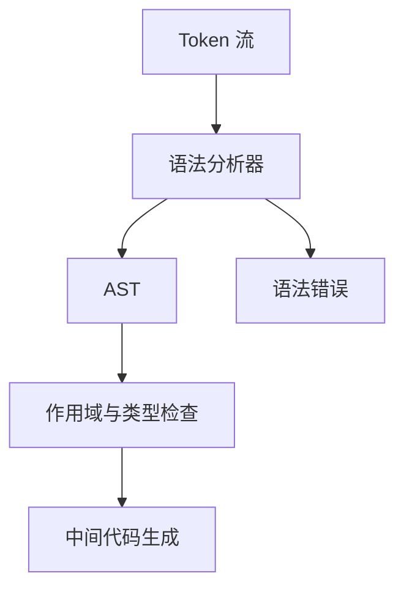
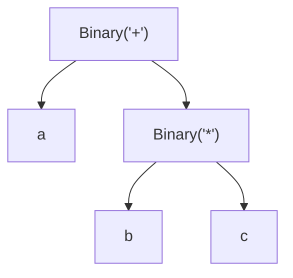
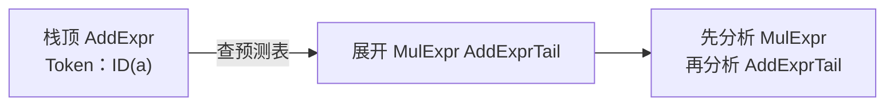
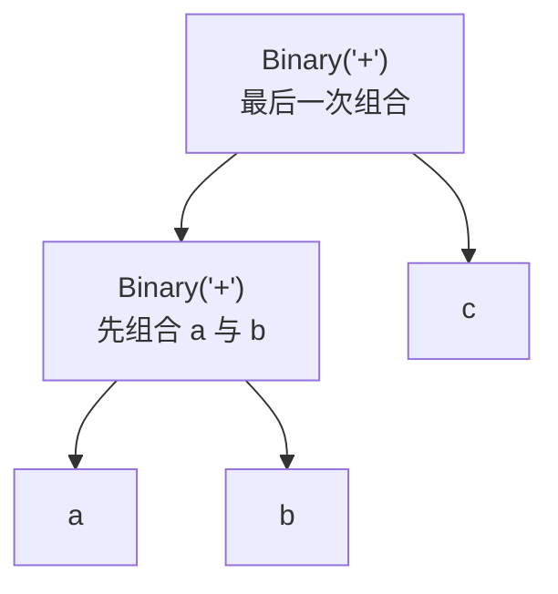
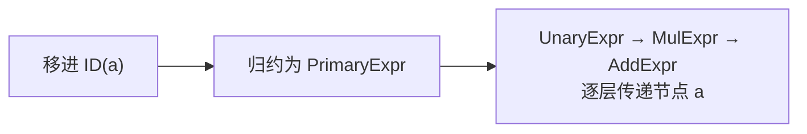
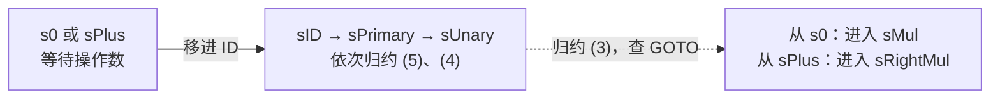
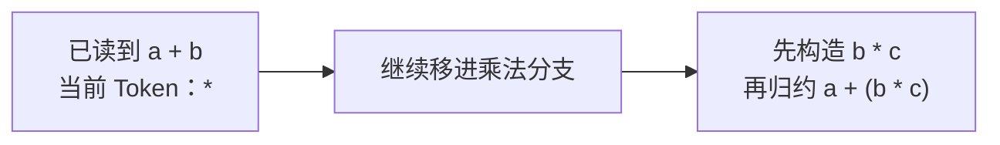

import ToyCGrammar from '@site/src/components/ToyCGrammar';

# 第二部分 · 语法分析

## 一、实验目标

语法分析器（parser）读取第一部分产出的 Token 流，检查它是否符合 ToyC 文法，并构造出后续语义分析和 IR 生成要用的抽象语法树（AST）。

:::info[基本原理]
语法分析依据文法将 Token 流组织为抽象语法树；树的层次结构表示运算符的优先级、结合性和程序结构。
:::



### 本部分的三条可选技术路线

本部分允许任选一条路线实现，但必须在报告中说明取舍理由：

| 路线 | 基本思路 | 实现难度 | 说明 |
| --- | --- | --- | --- |
| 递归下降 | 每个非终结符对应一个函数 | 低 | 便于手写与调试 |
| LL(1) | 预测分析表 + 显式栈 | 中 | 需要计算 FIRST / FOLLOW |
| LR(0) / SLR(1) | 项目集 + ACTION/GOTO 表 | 高 | 可保留左递归，自底向上归约；需要检查表冲突 |

三条路线的输入、输出和文法约定相同：都读取第一部分的 Token 流并生成同一套 AST。若选择 LL(1)，需要先消除左递归并提取左公因子；若选择 LR，则要在报告中说明冲突处理和归约动作。课程实现建议先用递归下降跑通，再把同一组样例用于路线对比。

## 二、ToyC 核心文法

本部分使用[词法与文法约定](../reference/grammar)中的 ToyC 文法。下面的定义与文法页共用同一份内容，各实验的产生式、终结符名称、优先级和结合性都以它为准。

下面使用 EBNF 记号：`[ ... ]` 表示可选，`*` 表示重复零次或多次，`+` 表示重复一次或多次，`|` 表示选择；单引号中的内容是终结符。

<ToyCGrammar />

ToyC 没有全局变量，`CompUnit` 只展开为函数定义。`getint`、`putint` 按普通 `ID` 和函数调用解析，不为库函数增加特殊产生式。

## 三、从 Token 到 AST 的转换逻辑

三条路线都要把 Token 组织成 AST，但驱动方式不同：递归下降由函数调用推进，LL(1) 根据栈顶和向前看 Token 查预测表，LR 根据状态栈查 ACTION/GOTO 表。AST 不保留没有语义的括号和分号，但保留源位置，用于后续报错。

### 结合性与优先级：以 `a + b * c` 为例

表达式文法按优先级分层：越靠下的规则优先级越高。解析 `a + b * c` 时，先识别加法（`AddExpr`），左侧得到 `a`；看到 `+` 后解析右侧的乘法子表达式，`MulExpr` 又把 `b * c` 组合成一棵子树。因此 AST 是 `+(a, *(b, c))`，而不是 `*(+(a, b), c)`：



如果用错误的方式解析（先算 `a + b` 再乘 `c`），结果就完全错了。这就是为什么文法要分层，以及为什么要区分左结合和右结合。

### 递归下降实现

**算法 1 · 递归下降解析表达式（Recursive-Descent Expression Parsing）**

**输入（Input）：** Token 流（`peek()` 返回当前 Token 但不消耗，`consume()` 消耗并前进）。
**输出（Output）：** 表达式对应的 AST 节点。

```
 1: parseExpr():                                    // Expr -> LOrExpr
 2:     return parseLOrExpr();
 3:
 4: parseAddExpr():                                 // AddExpr -> MulExpr | AddExpr ('+' | '-') MulExpr
 5:     left = parseMulExpr();
 6:     while peek() in { '+', '-' } do              // 左结合：用循环表达，而不是左递归
 7:         op = consume();
 8:         right = parseMulExpr();
 9:         left = Binary(op, left, right, loc = op.loc);   // 构造二元节点
10:     end while
11:     return left;
12:
13: parsePrimaryExpr():                            // 处理 PrimaryExpr 的四个分支
14:     if match(NUMBER) then
15:         return Number(previous().value);
16:     end if
17:     if match(ID) then
18:         name = previous().lexeme;
19:         if match('(') then return parseCallAfterName(name); end if
20:         return Variable(name);
21:     end if
22:     if match('(') then
23:         e = parseExpr();
24:         expect(')');                                // 括号不进 AST，但保留源位置
25:         return e;
26:     end if
27:     error("expected primary expression");           // 出错提示
```

**为什么这里用循环？** `AddExpr` 的递归分支以自身开头，照着产生式直接调用 `parseAddExpr()` 会无限递归。实现时先读一个 `MulExpr`，再用循环读取后续的 `+`、`-` 和 `MulExpr`，每次把新节点接在已有 AST 的外层。这样仍按 ToyC 文法构造左结合的表达式。

### LL(1)：计算 FIRST / FOLLOW 集

LL(1) 用栈顶非终结符和当前 Token 查预测分析表，决定接下来展开哪条产生式。第一个 L 表示从左到右读输入，第二个 L 表示最左推导，1 表示看一个向前看 Token。

#### 从 ToyC 产生式构造预测分析器

继续看 `return a + b;` 中的表达式。ToyC 的 `AddExpr` 和 `MulExpr` 含左递归，构造 LL(1) 表前，需要为它们引入处理后续运算的辅助符号；`PrimaryExpr` 的两个 `ID` 分支也需要提取共同前缀：

```text
AddExpr         -> MulExpr AddExprTail
AddExprTail     -> '+' MulExpr AddExprTail
                 | '-' MulExpr AddExprTail
                 | ε
MulExpr         -> UnaryExpr MulExprTail
MulExprTail     -> '*' UnaryExpr MulExprTail
                 | '/' UnaryExpr MulExprTail
                 | '%' UnaryExpr MulExprTail
                 | ε
PrimaryExpr     -> ID PrimaryExprTail
                 | NUMBER
                 | '(' Expr ')'
PrimaryExprTail -> '(' [ Expr (',' Expr)* ] ')'
                 | ε
```

`AddExprTail`、`MulExprTail`、`PrimaryExprTail` 是预测分析器的辅助符号，分别记录加减运算、乘除运算和函数调用后缀。其余规则仍来自上面的 ToyC 文法。构造完整分析表时，`RelExpr`、`LAndExpr`、`LOrExpr` 也需要消除左递归，还需把 EBNF 的可选项和重复项展开为普通产生式。

#### FIRST 与 FOLLOW 表示什么

- **FIRST**：这一部分可以从哪些 Token 开始？
- **FOLLOW**：这一部分读完后，哪些 Token 可以接在后面？

例如，`PrimaryExpr` 可由标识符、整数或左括号开始；`UnaryExpr` 还可以由一元 `+`、`-`、`!` 开始。因此 `AddExpr`、`MulExpr` 的 FIRST 都包含 `ID`、`NUMBER`、`(`、`+`、`-`、`!`。

为便于读表，记：

```text
F = { ID, NUMBER, '(', '+', '-', '!' }
K = { '<', '>', '<=', '>=', '==', '!=', '&&', '||', ')', ',', ';' }
```

`K` 是完整加减表达式之后允许出现的 Token 集合，包括更低优先级的运算符和表达式结束位置。下表的 FOLLOW 按引入尾部符号后的预测分析规则计算；`F`、`K` 是集合名称。

| 非终结符 | FIRST | FOLLOW |
| --- | --- | --- |
| `AddExpr` | `F` | `K` |
| `AddExprTail` | `{ '+', '-', ε }` | `K` |
| `MulExpr` | `F` | `K ∪ { '+', '-' }` |
| `MulExprTail` | `{ '*', '/', '%', ε }` | `K ∪ { '+', '-' }` |

在 `AddExpr -> MulExpr AddExprTail` 中，`AddExprTail` 可以从 `+` 或 `-` 开始，所以这两个 Token 进入 `FOLLOW(MulExpr)`。尾部也可以为空，因此 `FOLLOW(AddExpr)` 同样进入 `FOLLOW(MulExpr)`。FOLLOW 中不包含 `ε`。

#### 把集合填进预测分析表

对每条 `A -> α`：

1. 在 `FIRST(α)` 中每个非空终结符对应的列填入这条产生式；
2. 若 `α` 能推出 `ε`，在 `FOLLOW(A)` 对应的列也填入这条产生式；
3. 同一格出现两条不同产生式，说明这里有 LL(1) 冲突。

下面只列加法层的表项，其余层按同样的方法构造。`K` 列代表集合中的每一个 Token。

| 栈顶 / 当前 Token | `ID`、`NUMBER`、`(`、`!` | `+` | `-` | `K` 中的 Token |
| --- | --- | --- | --- | --- |
| `AddExpr` | `MulExpr AddExprTail` | `MulExpr AddExprTail` | `MulExpr AddExprTail` | 错误 |
| `AddExprTail` | 错误 | `'+' MulExpr AddExprTail` | `'-' MulExpr AddExprTail` | `ε` |

`AddExpr` 行中的 `+`、`-` 是一元运算符；`AddExprTail` 行中的 `+`、`-` 是跟在左操作数后面的二元运算符。同一个 Token 在不同栈顶下承担不同作用。



#### 跟着栈解析一次 a + b

栈从左到右表示“栈底 → 栈顶”。`Γ` 表示外层语句和表达式层的剩余栈；本例分析完 `AddExpr` 后，回到外层处理分号。`ID(a)`、`ID(b)` 表示携带词素的 `ID` Token。

下表将若干连续展开合并在一行；实现中仍逐条查表、展开。

| 步骤 | 分析栈 | 剩余输入 | 本步动作 |
| ---: | --- | --- | --- |
| 0 | `Γ AddExpr` | `ID(a) + ID(b) ;` | 展开为 `MulExpr AddExprTail`，逆序压栈 |
| 1 | `Γ AddExprTail MulExpr` | `ID(a) + ID(b) ;` | 展开 `MulExpr`、`UnaryExpr`、`PrimaryExpr`，得到下一行的栈 |
| 2 | `Γ AddExprTail MulExprTail PrimaryExprTail ID` | `ID(a) + ID(b) ;` | 匹配 `ID`，消耗 `a` |
| 3 | `Γ AddExprTail MulExprTail PrimaryExprTail` | `+ ID(b) ;` | `PrimaryExprTail`、`MulExprTail` 在 `+` 上选空分支 |
| 4 | `Γ AddExprTail` | `+ ID(b) ;` | 展开为 `'+' MulExpr AddExprTail` |
| 5 | `Γ AddExprTail MulExpr '+'` | `+ ID(b) ;` | 匹配 `+` |
| 6 | `Γ AddExprTail MulExpr` | `ID(b) ;` | 按步骤 1、2 的方式展开并匹配 `b` |
| 7 | `Γ AddExprTail MulExprTail PrimaryExprTail` | `;` | 三个尾部在 `;` 上依次选空分支 |
| 8 | `Γ` | `;` | 返回外层，表达式分析完成 |

展开产生式不消耗 Token，匹配终结符才前进。`ε` 不入栈，也不消耗输入。

**AST 仍保持左结合。** `AddExprTail` 虽采用右递归记录尾部，构造 AST 时要从左向右组合。对 `a + b + c`，先构造 `Binary('+', a, b)`，再与 `c` 组合。



<details>
<summary>算法 2：FIRST / FOLLOW 的通用计算</summary>

输入为上下文无关文法，输出为各符号的 FIRST 与各非终结符的 FOLLOW。`addAll` 向集合加入新元素，并在集合实际变化时返回 true。

```
 1: FIRST(terminal a) = {a}; FIRST(ε) = {ε};
 2: FIRST(nonterminal A) = ∅;
 3: repeat
 4:     changed = false;
 5:     for each production A -> X1 ... Xn do
 6:         changed = addAll(FIRST(A), FIRST(X1 ... Xn)) or changed;
 7:     end for
 8: until not changed
 9: FOLLOW(A) = ∅ for every nonterminal A; FOLLOW(start) = {$};
10: repeat
11:     changed = false;
12:     for each production A -> α B β, where B is a nonterminal do
13:         changed = addAll(FOLLOW(B), FIRST(β) minus {ε}) or changed;
14:         if ε in FIRST(β) then
15:             changed = addAll(FOLLOW(B), FOLLOW(A)) or changed;
16:         end if
17:     end for
18: until not changed
```

计算 `FIRST(X1 ... Xn)` 时，从左向右加入各 `FIRST(Xi)` 的非空元素；遇到不能推出空串的符号就停止。仅当整个序列都可为空时加入 `ε`，空序列的 FIRST 为 `{ε}`。

</details>

<details>
<summary>算法 3：LL(1) 表驱动解析</summary>

下面展示语法识别驱动；要生成 AST，还需在匹配与产生式完成时执行语义动作。

```
 1: stack = ['$', start]; pos = 0;
 2: loop
 3:     X = top(stack); a = lookahead(pos);
 4:     if X == '$' and a == '$' then return accept; end if
 5:     if X is a terminal then
 6:         if X != a then reportSyntaxError(); recover(); continue; end if
 7:         pop(stack); pos += 1;                      // 只在匹配时消耗 Token
 8:     else if M[X, a] contains A -> Y1 ... Yk then
 9:         pop(stack);
10:         push Yk, ..., Y1;                          // ε 的右部为空，不压栈
11:     else
12:         reportSyntaxError(); recover();            // 恢复必须推进输入或弹栈
13:     end if
14: end loop
```

</details>

完整的 ToyC 分析表还需处理赋值语句与表达式语句的共同前缀，以及 `else` 的归属。`else` 按文法页的约定匹配最近的未匹配 `if`。消除表达式左递归后，仍需检查整张表是否存在冲突。

FIRST/FOLLOW 与预测表的定义可参见 [威斯康星大学语法分析讲义](https://pages.cs.wisc.edu/~fischer/cs536.s08/course.hold/html/NOTES/5.PARSING.html)。

### LR：项目集与分析表

LR 从 Token 开始，自底向上归约出非终结符。`ACTION` 决定移进、归约、接受或报错，`GOTO` 决定归约后进入哪个状态。它可以保留 ToyC 文法中的左递归。

#### 移进与归约分别做什么

还是看 `return a + b;` 中的 `a + b`。它的分析会用到以下 ToyC 产生式，编号仅用于本例：

```text
(1) AddExpr     -> AddExpr '+' MulExpr
(2) AddExpr     -> MulExpr
(3) MulExpr     -> UnaryExpr
(4) UnaryExpr   -> PrimaryExpr
(5) PrimaryExpr -> ID
```

这些规则是上面完整文法的分支，`-`、乘除、整数、括号和调用等分支也要进入实际分析器的项目集。构造 LR 表前，将 EBNF 的选择、可选项和重复项展开为普通产生式，开始符号仍是 `CompUnit`。

- **移进**：把当前 Token 及目标状态压入栈，继续读下一个 Token。
- **归约**：按 `A -> β` 弹出右部 `β`，构造 AST 或传递节点，再按 `GOTO` 压入 `A` 和新状态；当前 Token 不前进。



#### 项目中的圆点表示什么

`AddExpr -> AddExpr · '+' MulExpr` 表示已经识别了左操作数，接下来期待 `+`；`AddExpr -> AddExpr '+' MulExpr ·` 表示右部已经完整，可以考虑归约。

从 `CompUnit′ -> · CompUnit` 开始做 CLOSURE：圆点后若是非终结符，就加入它的各条产生式，并将圆点放在右部开头；不断补充，直到没有新项目。

到达开始读取加法表达式的状态时，闭包需要包含 `AddExpr` 的所有分支，并继续展开 `MulExpr`、`UnaryExpr` 和 `PrimaryExpr`。例如，其中会有：

```text
AddExpr     -> · MulExpr
AddExpr     -> · AddExpr '+' MulExpr
AddExpr     -> · AddExpr '-' MulExpr
MulExpr     -> · UnaryExpr
UnaryExpr   -> · PrimaryExpr
PrimaryExpr -> · ID
```

这里仅列与本例有关的项目。实际闭包还包含乘除、一元运算、整数、括号和调用等项目。`GOTO(J, X)` 把状态 `J` 中圆点后为 `X` 的项目右移一位，再取闭包，得到新的状态。

分析 `a + b` 时，两个 `ID` 都要逐层归约成 `MulExpr`。下图将连续归约合并展示：左操作数从 `s0` 开始，右操作数从读过 `+` 的 `sPlus` 开始，因此归约后查到的 GOTO 不同。状态标签用于讲解，具体编号由项目集构造顺序决定。



左操作数在 `sMul` 继续归约为 `AddExpr`，进入 `sAdd`；移进 `+` 后进入 `sPlus`，开始读右操作数。右操作数归约后进入 `sRightMul`，此时加法产生式的右部已完整，便可以构造加法节点。

#### 由项目集填写 SLR(1) 表

表项来自三类信息：

1. 终结符转移 `J --a--> K` 对应 `ACTION[J, a] = shift K`；
2. 完整项目 `A -> β ·` 只在 `FOLLOW(A)` 的 Token 列填写 `reduce A -> β`；
3. 增广开始项目 `CompUnit′ -> CompUnit ·` 在输入结束符 `$` 上填写 `accept`。

非终结符转移写入 GOTO 表。下面只列本例需要的 ACTION 表项，其他列仍需按完整文法构造。

| 状态 | 当前 Token | ACTION | 归约后的 GOTO |
| --- | --- | --- | --- |
| `s0` | `ID` | 移进 `sID` | — |
| `sID` | `+` 或 `;` | 归约 (5) `PrimaryExpr -> ID` | 从弹栈后的状态进入 `sPrimary` |
| `sPrimary` | `+` 或 `;` | 归约 (4) `UnaryExpr -> PrimaryExpr` | 进入 `sUnary` |
| `sUnary` | `+` 或 `;` | 归约 (3) `MulExpr -> UnaryExpr` | 从 `s0` 进入 `sMul`；从 `sPlus` 进入 `sRightMul` |
| `sMul` | `+` | 归约 (2) `AddExpr -> MulExpr` | 进入 `sAdd` |
| `sAdd` | `+` | 移进 `sPlus` | — |
| `sPlus` | `ID` | 移进 `sID` | — |
| `sRightMul` | `;` | 归约 (1) `AddExpr -> AddExpr '+' MulExpr` | 回到 `sAdd` |

`+`、`;` 都属于 ToyC 中 `FOLLOW(PrimaryExpr)`、`FOLLOW(UnaryExpr)`、`FOLLOW(MulExpr)` 的成员，所以本例可在这些位置逐层归约。`AddExpr` 归约完成后还要经过 `RelExpr`、`LAndExpr`、`LOrExpr`、`Expr`，最后由外层语句处理分号。

#### 跟着栈解析一次 a + b

`Γ` 表示尚未展开列出的外层符号，`Σ` 表示对应的外层状态栈。以下仅列加法表达式对应的栈段。

| 步骤 | 状态栈段 | 符号栈段 | 剩余输入 | 本步动作与 AST |
| ---: | --- | --- | --- | --- |
| 0 | `Σ s0` | `Γ` | `ID(a) + ID(b) ;` | 移进 `a` |
| 1 | `Σ s0 sID` | `Γ ID` | `+ ID(b) ;` | 按 (5)、(4)、(3)、(2) 逐层归约，传递节点 `a` |
| 2 | `Σ s0 sAdd` | `Γ AddExpr` | `+ ID(b) ;` | 移进 `+` |
| 3 | `Σ s0 sAdd sPlus` | `Γ AddExpr '+'` | `ID(b) ;` | 移进 `b` |
| 4 | `Σ s0 sAdd sPlus sID` | `Γ AddExpr '+' ID` | `;` | 按 (5)、(4)、(3) 逐层归约，传递节点 `b` |
| 5 | `Σ s0 sAdd sPlus sRightMul` | `Γ AddExpr '+' MulExpr` | `;` | 按 (1) 弹出三个符号，构造 `Binary('+', a, b)` |
| 6 | `Σ s0 sAdd` | `Γ AddExpr` | `;` | 继续归约为外层 `Expr`，再分析分号 |

LL(1) 先展开 `AddExpr` 再匹配 Token；LR 先读取 Token 再归约成 `AddExpr`。两条路线最终得到同一棵加法 AST。

#### LR(0)、SLR(1) 与表冲突

| 方法 | 完整项目 `A -> β ·` 在哪些 Token 上归约 | 影响 |
| --- | --- | --- |
| LR(0) | 所有终结符列 | 不利用后继 Token 限制，较容易与其他动作冲突 |
| SLR(1) | 仅 `FOLLOW(A)` 中的终结符列 | 用 FOLLOW 集限制归约位置 |

ToyC 中，某个状态可能同时含有 `AddExpr -> MulExpr ·` 和等待乘除运算符的 `MulExpr` 项目。当前 Token 为 `*` 时，应继续读取乘法；`*` 不在 `FOLLOW(AddExpr)` 中，SLR(1) 因此不会在这一列归约 `AddExpr`。



同一表格单元同时需要移进与归约，称为移进-归约冲突；同时需要两种归约，称为归约-归约冲突。若完整 ToyC 的 SLR 表仍有冲突，应检查产生式展开和消歧规则，或采用 LR(1)/LALR(1)。`else` 按文法页的约定匹配最近的未匹配 `if`。

运行时查到空表项表示输入的语法错误，与构造表时的冲突是两回事。

<details>
<summary>算法 4：CLOSURE / GOTO 与 LR(0) 项目集规范族</summary>

```
 1: closure(seed):
 2:     J = seed;
 3:     repeat
 4:         changed = false;
 5:         for each item A -> α · B β in J, where B is a nonterminal do
 6:             for each production B -> γ do
 7:                 changed = addAll(J, {B -> · γ}) or changed;
 8:             end for
 9:         end for
10:     until not changed
11:     return J;
12:
13: goto(J, X):
14:     moved = {A -> α X · β | A -> α · X β is in J};
15:     return closure(moved);
16:
17: states = {closure({CompUnit′ -> · CompUnit})}; worklist = states;
18: while worklist not empty do
19:     J = pop(worklist);
20:     for each grammar symbol X do
21:         K = goto(J, X);
22:         if K is not empty then
23:             if K is new then add K to states and worklist; end if
24:             recordTransition(J, X, K);
25:         end if
26:     end for
27: end while
```

构造时对项目集合去重，并给每个不同集合分配状态编号。项目相同、集合相同的状态可以复用，不能因为从另一条边到达就重复创建。

</details>

<details>
<summary>算法 5：LR 移进-归约驱动器</summary>

符号栈的每个元素同时记录文法符号与语义值（Token 或 AST 节点）。

```
 1: states = [0]; symbols = []; pos = 0;
 2: loop
 3:     s = top(states); a = lookahead(pos);
 4:     if ACTION[s, a] == shift t then
 5:         push(states, t); push(symbols, tokenAt(pos)); pos += 1;
 6:     else if ACTION[s, a] == reduce (A -> β) then
 7:         children = pop |β| symbols in their original order;
 8:         pop |β| states;                          // ε 归约时弹出 0 个
 9:         value = semanticAction(A -> β, children);
10:         push(symbols, (A, value));
11:         push(states, GOTO[top(states), A]);       // 使用弹栈后的栈顶状态
12:     else if ACTION[s, a] == accept then
13:         return top(symbols).value;
14:     else
15:         reportSyntaxError(); errorRecovery();   // 空格表示语法错误
16:     end if
17: end loop
```

</details>

### 错误恢复

**算法 6 · 语法错误恢复（Panic-Mode Error Recovery）**

**输入（Input）：** 出错位置，以及当前非终结符的期望集合。
**输出（Output）：** 完成同步的解析位置。

```
 1: report_error(expect, actual, line, col);          // 报出期望、实际、行列
 2: sync = { ';', '}' } ∪ { 'if', 'while', 'return' };    // 语句级同步集合
 3: while not eof() and lookahead() ∉ sync do
 4:     advance();                                     // 丢弃 Token，直到遇到同步符号
 5: end while
 6: if lookahead() ∈ { ';', '}' } then advance(); end if  // 跳过直至同步符号
 7: return current_position();                         // 继续解析后续语句
```

例如语句解析失败后，跳过到 `;`、`}` 或控制语句关键字，再继续解析后续语句，减少同一错误引发的连续报错。

## 四、AST 设计

```
Program(functions)
Function(return_type, name, params, body)
Block(statements)
Decl(name, initializer, is_const)     // 一条声明语句可含多个声明项，拆成一组节点
If(condition, then_stmt, else_stmt?)
While(condition, body)
Empty / Break / Continue
Assign(name, value)
Binary(op, lhs, rhs)
Unary(op, operand)
Call(name, args)
Number(value)
Variable(name)
Return(value?)
```

AST 应丢弃不影响语义的括号和分隔符，但保留源位置，便于错误报告。

## 五、选做：语义分析

语法分析完成后，可以继续阅读[选做 · 语义分析](./optional-semantic)，在 AST 与 IR 生成之间加入符号表、作用域、类型和控制流约束检查。语义分析不属于本部分的必做提交。

## 六、输入输出规范与统一样例

### 输入形式

- 输入为 ToyC 源代码，从标准输入流读入：

  ```bash
  echo "int a = 1;" | ./compiler -ast > test.check-ast
  ```

- 本地调试时用文件重定向：

  ```bash
  ./compiler -ast < test.c > test.check-ast
  ```

### 输出形式

所有输出都写到标准输出流；本地调试时用重定向写入文件，例如 `./compiler -ast < test.c > test.check-ast`，文件名建议用 `.check-ast` 后缀，便于与助教脚本对账。

源代码没有语法错误时，输出一行：

```text
accept
```

源代码存在语法错误时，先输出一行 `reject`，随后每行给出一个错误位置，按出现顺序排列：

```text
<行号>[ 空格 <报错信息>]
```

报错信息是可选字段，用空格与行号分隔，写不写都不影响判分。例如：

```text
reject
12 Lack of ')'
34 Unterminated comment
56 Lack of ';'
```

也可以只写行号：

```text
reject
12
34
56
```

:::warning[判分只看首行和行号]
自动评测只检查两件事：首行是 `accept` 还是 `reject`，以及 `reject` 之后各行的行号。

- 行号从 `1` 开始（源程序的第一行是第 1 行）；
- 行号取的是解析器发现错误时手上那个意外 Token 所在的行。例如少了 `;`，报出的就是它后面那个 Token 所在的行；
- 每个测试用例里的语法错误都独立成一处，不会出现"一个错误跨多行"或"一行多错"。
:::

### 样例输入

与词法分析、目标代码生成共用同一个样例程序：

```c
// ToyC 综合示例：覆盖文法中的全部成分
/* ToyC 不支持全局变量，所有定义都写在函数里 */

int sum(int n, int from) {
    int s = 0;
    while (from <= n) {
        if (from == 2) {
            from = from + 1;
            continue;
        }
        s = s + from;
        from = from + 1;
    }
    return s;
}

void show(int v) {
    putint(v);
    ;
}

int main() {
    const int LIMIT = 3, STEP = 1;
    int a = 5, b;
    b = +a - -1;
    int c = (a + b) * 2 / 3 % 4;
    {
        int a = 1;
        c = c + a;
    }
    if (a >= b && b != 0 || !(a == LIMIT)) {
        c = c + sum(a, STEP);
    } else {
        c = c - 1;
    }
    while (c > 0) {
        c = c - 1;
        if (c == 5) continue;
        if (c < 2) break;
        show(c);
    }
    return c;
}
```

### 样例输出

这个程序没有语法错误，因此只输出一行：

```text
accept
```

### 错误样例

再给一个故意写错的程序，覆盖几类最常见的语法错误：

```c
int f(int x, int y {
    int z = x + y  / 2 % 3;
    if (z < 10 && z > 0 || z <= 20 && z >= 5 || z == 7 || z != 8) {
        z = z + 1;
    } else {
        z = z - ;
    }
    while (z < 100) {
        z = z + 1;
        if z == 50) break;
        continue;
    }
    return z;


void g() {
    int i = 0;
    i = f(i, i);
}

int main() {
    int result = 0;
    result = f(, 2);
    g();
    return result;
}
```

五处错误逐个说明：

| 行号 | 出错位置 | 语法错误 |
| ---: | --- | --- |
| 1 | `int f(int x, int y {` | 形参列表缺少 `)` |
| 6 | `z = z - ;` | 二元运算符 `-` 缺少右操作数 |
| 10 | `if z == 50) break;` | `if` 的条件缺少 `(` |
| 16 | `void g() {` | 上一个函数体缺少 `}`，`void g()` 被当成 `f` 函数体里的语句 |
| 23 | `result = f(, 2);` | 实参列表里多了一个逗号，缺少实参 |

对应的输出（报错信息可以省略）：

```text
reject
1 Lack of ')'
6 Lack of expression
10 Lack of '('
16 Lack of '}'
23 Lack of expression
```

第 16 行缺少前一个函数的结束符 `}`，解析器因此将 `void g()` 作为 `f` 函数体中的语句处理，并在 `void` 处报错。
报告错误后，应跳过 Token，直到语句级同步集合（`;`、`}`、`if`、`while`、`return`）中的符号，再继续解析。
具体策略见“错误恢复”一节的 panic-mode 恢复。

## 七、提交物

第二部分必须提交可以编译的完整文件。程序应读取 ToyC 源程序，按命令行参数选择解析模式，并按第六节的规定输出 `accept` / `reject`；不能只提交算法片段。

```bash
cmake -S . -B build
cmake --build build
./compiler -ast < input.c > input.check-ast
./compiler -ast --parser ll1 < input.c > input.check-ast
```

报告需包含：文法改写、FIRST/FOLLOW 集、分析表或递归下降实现、AST 节点设计和错误恢复策略。
