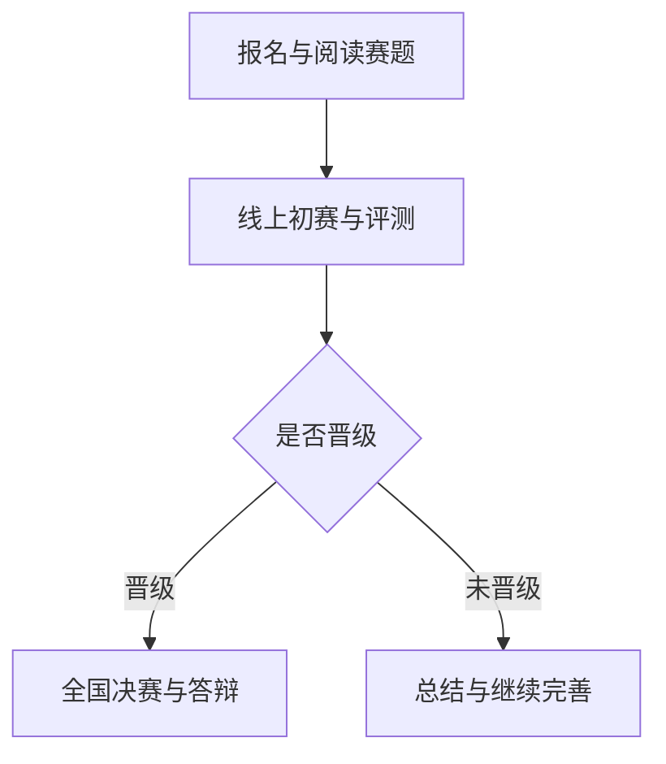
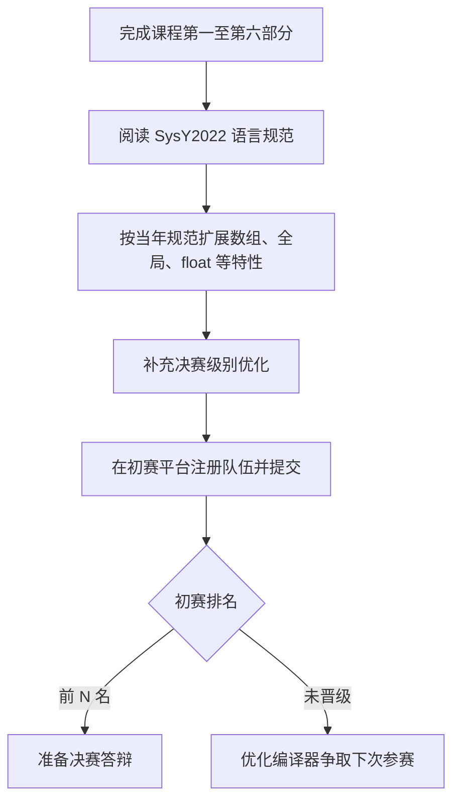

# 第七部分 · 编译系统赛

:::info[比赛与课程的关联]

本课程的 ToyC 编译器覆盖编译系统实现赛所需的主要基础环节。
完成第一至第六部分后，通常已具备搭建参赛编译器的基础，但仍需根据当年赛题扩展语言支持、补充优化并完善工程化测试。
:::

## 一、比赛简介

**全国大学生计算机系统能力大赛**（Computer System Development Capability Competition，CSCC）由全国高等学校计算机教育研究会、系统能力培养研究专家组与项目发起高校共同主办。组织单位与赛道安排见[官方网站](https://compiler.educg.net/)。

编译系统设计赛分为实现赛与挑战赛，具体要求按年度发布：

| 赛道 | 面向对象 | 内容 | 后端平台 |
| --- | --- | --- | --- |
| **编译系统实现赛** | 高等院校在校本科生 | 实现一个完整的编译器，将 SysY 源码编译为可运行的机器码 | ARM / RISC-V |
| **编译系统挑战赛** | 高等院校在校本科生、研究生 | 在已有框架基础上完成高难度优化挑战 | 依赛题而定 |

**官方网站**：[https://compiler.educg.net/](https://compiler.educg.net/)

## 二、课程实验与备赛

- **已有实现**：课程实验中的前端、IR、代码生成和优化模块可作为参赛编译器的基础。
- **补充内容**：根据当年赛题扩展语言特性，补充性能优化和测试工具。
- **小组协作**：明确前端、中端、后端与测试的分工，并预留接口联调和代码整合时间。

## 三、赛制与时间线

### 3.1 竞赛阶段

竞赛通常包含报名、线上初赛与全国决赛，不能把某一年的日期视为每年固定安排。[2026 年官方章程与赛事页面](https://course.educg.net/pages/contest/contest.jsp?contestCID=0&contestID=Zd6BcaiCWJ4&doVisit=true&my=false)给出的报名截止日为 5 月 30 日，初赛提交截止日为 8 月 5 日。每队不超过 4 人；后续年度需重新核对日期、资格与提交规则。



### 3.2 评分方式

| 维度 | 说明 |
| --- | --- |
| **功能正确性** | 编译器对测试用例生成的汇编能否正确运行（与参考输出比对） |
| **性能优化** | 编译器生成的代码在规定测试用例上的运行效率（运行时间 / 内存占用） |

各阶段的权重、性能指标和答辩要求以对应技术方案及评测说明为准。章程没有给出一套通用的固定权重。

## 四、比赛语言：SysY

SysY（System Language Y）是比赛官方指定的源语言，是一种 C 语言子集，经过适度扩展而成。

### 4.1 基本特性

| 特性 | 说明 |
| --- | --- |
| 数据类型 | `int`（32 位有符号整数）、`float`（32 位单精度浮点） |
| 复合类型 | 多维数组（按行优先存储） |
| 常量修饰符 | `const` |
| 程序入口 | 必须有且仅有一个 `main` 函数，无参数，返回 `int` |
| 注释 | C 风格 `// 单行` 和 `/* 多行 */` |

### 4.2 支持的语句

- 变量 / 常量声明（局部 / 全局）
- 赋值语句、表达式语句
- `if / if-else` 条件分支
- `while` 循环、`break`、`continue`
- `return` 语句
- 语句块（`{}`）

### 4.3 运算符

- 算术运算：`+ - * / %`
- 关系运算：`== != < > <= >=`
- 逻辑运算：`! && ||`
- 赋值运算：`=`

### 4.4 运行时库

比赛提供标准运行时库（类似本课程的 `libtoyc.a`），I/O 与计时通过库函数实现：

#### I/O 函数

| 函数 | 说明 | 返回值 |
|---|---|---|
| `int getint()` | 从标准输入读取一个整数 | 读取到的整数值 |
| `int getch()` | 从标准输入读取一个字符 | 字符对应的 ASCII 码 |
| `float getfloat()` | 从标准输入读取一个浮点数 | 读取到的浮点数值 |
| `int getarray(int[])` | 第 1 个整数表示后续要输入的整数个数 n，返回 n；后续 n 个整数写入传入的数组。注：不检查数组空间是否足够 | 输入的整数个数 |
| `int getfarray(float[])` | 第 1 个整数表示后续要输入的浮点数个数 n，返回 n；后续 n 个浮点数写入传入的数组。注：不检查数组空间是否足够 | 输入的浮点数个数 |
| `void putint(int value)` | 向标准输出写入一个整数值 | 无 |
| `void putch(int ascii)` | 将整数参数作为 ASCII 码输出对应字符（参数范围 0~255，不做合法性检查） | 无 |
| `void putfloat(float value)` | 向标准输出写入一个浮点数值 | 无 |
| `void putarray(int n, int[])` | 输出 n 个整数，整数之间安插空格。注：不检查参数合法性 | 无 |
| `void putfarray(int n, float[])` | 输出 n 个浮点数，浮点数之间安插空格。注：不检查参数合法性 | 无 |
| `void putf(char[], int, ...)` | 第 1 个参数是格式串，仅支持 `%d`（整数）、`%c`（字符）、`%f`（浮点）；普通字符原样输出，格式符依次取后续参数值输出 | 无 |

#### 计时函数

| 函数 | 说明 | 返回值 |
|---|---|---|
| `void starttime()` | 开启计时器，应与 `stoptime()` 配对使用。不支持嵌套调用 | 无 |
| `void stoptime()` | 停止计时器。程序结束时统一输出各计时器的累计时间，格式为 `Timer#编号@开启行号-停止行号: 时-分-秒-微秒`，最后输出 TOTAL 行 | 无 |

:::info
ToyC 编译器不能直接处理完整 SysY。需要补充数组与初始化列表、全局声明、float、常量表达式及运行时接口；SysY2022 还区分普通 Exp 与条件 Cond，关系与相等运算的文法层级也需按其规范调整。
:::

### 4.5 SysY2026 扩展

2026 年赛题在 SysY2022 基础上新增了张量（tensor）类型：

```text
// SysY2026 扩展片段，不是 ToyC 或标准 C
tensor int a[4] = {1, 2, 3, 4};
tensor float b[2][3];

// 矩阵乘法运算符 @
tensor int A[2][2] = {1, 2, 3, 4};
tensor int B[2][2] = {5, 6, 7, 8};
tensor int C[2][2] = A @ B;
```

课程实验暂不要求支持张量类型，有余力的同学可以尝试扩展。

## 五、目标代码平台

编译系统实现赛的后端平台依赛题而定，参赛队需按当年赛题要求生成对应目标代码。

- **RISC-V（RV64GC）**：本课程全程使用的目标平台，工具链为 `riscv64-unknown-elf-*`，运行环境为 QEMU RISC-V。
- **ARM**：另一个后端方向；具体处理器、ABI 与工具链按当年技术方案配置。

:::tip[推荐选 RISC-V]
本课程实验全程使用 RISC-V 工具链，选择 RISC-V 赛道可以直接复用课程积累的工具链、运行时库和测试经验。仍须核对比赛的 ABI、链接和运行时约定，不能直接假定与课程完全相同。
:::

## 六、往届参赛经验

[官方开源展示](https://compiler.educg.net/en/index.html)列出了以下队伍与学校，可结合仓库阅读实现：

| 队伍 | 学校 | 备注 |
| --- | --- | --- |
| [不队](https://github.com/AdUhTkJm/sysy-competition) | 剑桥大学 | RISC-V 方向开源实现|
| [0x676e616c63](https://gitlab.eduxiji.net/T202510614205710/gnalc) | 电子科技大学 | ARM 方向开源实现 |

### 6.1 初赛优化范围与实现建议（参考）

第五、六部分介绍的是通用的基础优化，并不构成初赛优化要求的完整清单。初赛实现通常还需要结合测试程序和目标平台补充下列方向；具体支持范围、评测指标和可用假设以当年赛题与评测说明为准。

| 优化项 | 说明 | 优先级 |
| --- | --- | :---: |
| 死代码消除（DCE） | 删除无副作用且结果不再使用的指令，并清理经可达性分析确认不可达的基本块 | 高 |
| 常量折叠（CF） | 编译期计算常量表达式 | 高 |
| 代数简化 | 如 `a*1 → a`、`a+0 → a` | 中 |
| 分支优化 | 消除恒真/恒假分支 | 中 |
| Mem2Reg | 将栈上局部变量提升为 SSA 值 | 高 |
| 尾递归优化 | 将满足尾调用条件的递归调用改写为循环或跳转，减少调用栈开销 | 中 |
| 循环展开 | 将多次迭代的循环体合并到一次迭代中，减少条件判断与跳转，并暴露指令并行机会；正确处理不足一个展开组的剩余迭代，同时控制代码体积和寄存器压力 | 中 |
| 循环削弱（归纳变量简化） | 识别循环中按固定关系同步变化的多个变量，保留一个主归纳变量，其余变量由线性关系在需要时恢复或计算，在保持语义等价的前提下减少重复更新和运算 | 中 |
| 循环旋转 | 调整循环入口和条件检查位置，减少控制流开销并暴露后续优化机会 | 中 |
| 循环交换 | 调整嵌套循环顺序，改善数组访问的局部性 | 中 |
| 循环融合 | 合并迭代空间相同或兼容的循环，减少循环控制和重复遍历 | 中 |
| 循环分割 | 按条件、访问模式或热冷路径拆分循环，简化热点路径 | 中 |
| 并行操作等待 | 根据目标指令延迟安排独立操作，减少访存或高延迟指令造成的流水线停顿 | 中 |
| 寄存器分配与溢出 | 比较线性扫描、图着色等分配策略，设计合理的 spill/reload 选择，尽量减少溢出及其引入的内存访问 | 高 |
| 公共子表达式消除（CSE） | 在表达式仍然有效时复用已有计算结果 | 高 |
| 循环不变代码外提（LICM） | 将满足安全条件的循环不变量移到循环外 | 中 |
| 强度削减 | 将可证明等价的高代价运算替换为低代价运算 | 中 |
| 图着色寄存器分配 | 在冲突图上分配物理寄存器，并比较不同 spill 选择策略 | 中 |

循环往往占据程序的大部分运行时间，也是性能分数的主要来源。备赛时应先通过计时和热点分析定位循环，再评估循环变换、指令调度和寄存器分配对实际用例的收益；不要只根据静态指令数判断优化效果。

### 6.2 决赛优化建议（参考）

决赛可能加入课程和初赛清单之外的新语言特性、测试模式或优化方向。下表只能作为准备方向，不能视为决赛题目的完整预测；决赛同时考察参赛队理解新约束、验证实现假设并快速调整编译器的应变能力。

| 优化项 | 说明 | 优先级 |
| --- | --- | :---: |
| 测试集驱动的热点循环特化 | 根据性能样例定位热点，针对稳定的边界、步长和分支模式生成专门路径 | 高 |
| 循环分块与缓存 tiling | 按缓存容量和数据访问次序分块，减少大数组处理中的缓存未命中 | 高 |
| 访存布局与数据复用 | 调整数组遍历顺序、数据布局和加载时机，提高缓存命中率 | 高 |
| 热点循环的软件流水 | 根据目标指令延迟和循环依赖关系交错安排不同迭代的操作，在寄存器压力可控的前提下隐藏访存延迟 | 中 |
| 面向测试集的代码布局 | 根据热点路径和分支频率调整基本块布局，减少冷路径干扰和跳转开销 | 中 |
| 访存预取与延迟隐藏 | 在目标平台允许的前提下安排预取或独立指令，降低长延迟访存影响 | 低 |

决赛阶段不再把基础优化清单当作主要目标，而应围绕实际性能样例进行测量、定位和迭代。重点关注热点循环、数组访问和缓存命中；任何变换都需要用完整测试集验证功能正确性，并确认代码体积、寄存器压力和额外访存没有抵消收益。

## 七、如何开始备赛

完成课程前六个实验部分后，可按以下步骤准备参赛；语言范围和优化要求以当年赛题为准：



### 7.1 参考文档

以下文档可从 [资源下载](../reference/downloads#竞赛与调试文档) 页面下载：

- **SysY2022 语言定义**：SysY2022 的语言规则，后续扩展需另行核对
- **SysY2022 运行时库**：了解运行时函数接口
- **QEMU 本地调试指南**：在 QEMU 中单步调试编译器生成的汇编代码
- **SysY2026 扩展规范**：站内提供的 2026 张量扩展参考

### 7.2 推荐学习路径

| 阶段 | 内容 | 时间参考 |
| --- | --- | --- |
| 1 | 完成课程第一至第四部分（词法 → 代码生成） | 学期内完成 |
| 2 | 阅读 SysY 语言规范，对照课程实验做语言适配 | 1–2 周 |
| 3 | 在初赛平台注册，熟悉在线提交与评分流程 | 1 周 |
| 4 | 补充基础优化并准备测试集驱动的循环、缓存优化 | 2–3 周 |
| 5 | 大量测试，发现并修复 bug，冲性能分 | 初赛前 2 周 |

## 八、常见问题

### Q：课程用的是 ToyC，比赛用的是 SysY，区别大吗？

课程实现可以复用编译阶段的结构，但语言支持范围有明显差异。数组、全局变量、浮点、初始化列表、常量表达式与条件文法都需按 SysY 规范实现和测试，不能只增加 float 关键字。

### Q：4 人队伍如何分工？

一个常见的分工模式：

**前期（前端阶段）**：4 人一起实现，词法分析、语法分析、语义分析这 3 块并行推进，互相 review 与集成。

| 阶段 | 成员 | 主要负责 |
| --- | --- | --- |
| 前期 | 成员 A、B、C、D | 前端：词法分析、语法分析、语义分析（4 人一起实现） |
| 中后端 | 成员 A、B | 中端：IR 生成、IR 优化（2 人实现） |
| 中后端 | 成员 C、D | 后端：目标代码生成与目标代码优化（2 人实现） |

:::info
中端、后端阶段的拆分可以按个人兴趣与方向调整，但前期建议 4 人全员投入前端，这样大家对编译器整体架构了解比较清楚，方便决赛修改。
:::

决赛前需要提前合并（前后端联调），建议至少留出 2 周整合时间。

### Q：没有学过体系结构能参加吗？

可以从课程开始学习，但编译器后端仍须自行完成指令选择、寄存器分配、栈帧布局与 ABI 处理。汇编器负责把合法汇编编码，链接器负责符号与重定位，不会替你的编译器完成这些步骤。

### Q：决赛现场答辩需要准备什么？

按组委会当年通知准备源码、设计说明、演示或答辩材料，并能解释优化的正确性、测量结果和测试覆盖。演示时长、视频格式、开源平台与设备要求需逐项核对通知。

## 九、报名信息

报名时间、参赛条件和当年赛题见[比赛官方网站](https://compiler.educg.net/)。有参赛计划的同学们应确认报名与提交时间，并按照赛题检查已有编译器的语言支持范围。
