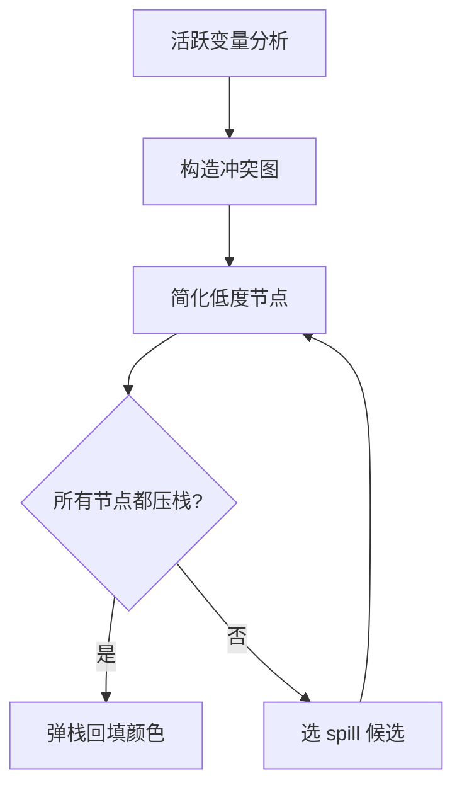

# 图着色寄存器分配（Graph Coloring）

图着色（Graph Coloring）是寄存器分配的经典模型；实际编译器会用简化、合并和 spill 启发式求一个质量较好的近似解。
把活跃区间视为节点、冲突视为边，目标是用 K 个物理寄存器（颜色数）给图着色，
使任意边的两个端点颜色不同。

## 一、问题形式化

**输入（Input）：** 冲突图 `G = (V, E)`，可用物理寄存器集合 `R`（`|R| = K`）。
**输出（Output）：** 着色函数 `color: V -> R`，使得任意边 `{u, v} ∈ E` 都满足 `color(u) ≠ color(v)`。

如果 |R| 个颜色足以覆盖图 G，则 G 是 K-可着色的。

## 二、K 着色是 NP 完全问题

任意 K ≥ 3 的图着色是 NP 完全问题。所以实际分配器都用启发式：

- 简化（Simplify）：暂时移除度 < K 的节点并压栈；回填时最多有 K−1 个邻居占用颜色，因此至少剩一个可用颜色；
- 选择 spill 候选：没有低度节点时，暂时移除一个高代价较低的节点；候选仍有可能在回填时获得颜色；
- 回填（Assign）：从栈中弹回节点，按邻居颜色挑一个未用颜色；
- Spill：发现颜色不够时回溯引入 spill。



## 三、Briggs 简化

下面展示不含预着色节点与合并操作的乐观简化骨架。实际实现还需保留物理寄存器约束：

**算法 · 简化阶段（Briggs Simplify）**

**输入（Input）：** 冲突图 `G`、可用颜色数 `K`。
**输出（Output）：** 待回填的节点栈 `stack`。

```
 1: simplify(G, K):
 2:     stack = [];
 3:     work = copyGraph(G);                              // 原图留给回填阶段
 4:     while work has unremoved nodes do
 5:         v = findNodeWithDegreeLessThan(work, K);        // 使用当前图中的度数
 6:         if v == none then
 7:             v = chooseSpillCandidate(work);            // 乐观候选，暂不插入访存
 8:         end if
 9:         stack.push(v);
10:         work.removeNodeAndIncidentEdges(v);            // 更新邻居度数与低度工作集
11:     end while
12:     return stack;
```

找不到度 < K 的节点不代表图不可着色。例如偶数环每点度数都是 2，却仍可用 2 种颜色着色；高阶节点只是候选，是否 spill 在回填阶段确定。

## 四、合并（Coalescing）

`mv t0, t1` 形式的 move 指令把 `t0` 和 `t1` 关联起来。没有冲突是合并的必要条件；还要检查合并后的邻居约束，避免把可着色的图变成不可着色的图。

合并需要谨慎——激进合并可能引入新的 spill。George 与 Briggs 都提供保守判据：Briggs 检查合并后的高度邻居数；George 检查一个节点的邻居是否已与另一个节点冲突或为低度节点。具体条件与预着色节点处理见 [George 与 Appel 的原论文](https://www.cs.tufts.edu/comp/150FP/archive/andrew-appel/iterated.pdf)。

## 五、冻结（Freeze）

合并机会耗尽时，"低度但合并受阻"的节点被冻结——不再尝试合并，但仍参与简化。

## 六、Spill 选择

如果简化到所有节点度 ≥ K 都无法删除，就要选 spill 候选：

```text
优先级考虑：
1. 动态定义与使用频率（可用循环深度或 profile 加权）
2. load/store 和跨调用保存的代价
3. 移除该节点能释放多少冲突约束
4. 是否能廉价 rematerialize，且所依赖的值仍可用
5. 是否已反复 spill，需要区间分裂或其它策略
```

Chaitin 的 cost heuristic：

```cpp
double spill_cost(LiveRange r) {
    double uses = count_uses(r);
    double degree = r.interference_degree;
    return uses / (degree + 1);
}
```

`cost` 越小越适合 spill。

## 七、回填颜色

栈中节点按压栈逆序弹回，每个节点扫描邻居已用颜色，挑第一个未用的：

**算法 · 回填颜色（Assign Colors）**

**输入（Input）：** 节点栈 `stack`、冲突图 `G`、可用颜色数 `K`。
**输出（Output）：** 每个节点的颜色，或标记为 spill。

```
 1: assignColors(stack, G, K):
 2:     while stack not empty do
 3:         v = stack.pop();                            // 按压栈逆序弹回
 4:         used = colorsOfNeighbors(v, G);
 5:         c = firstColorNotIn(used, K);               // 挑一个邻居没用过的颜色
 6:         if c != none then assign(v, c);
 7:         else
 8:             markForSpill(v);                        // K 个颜色都不够 -> spill
 9:             spills.add(v);                           // 完成回填后统一重写
10:         end if
11:     end while
```

若所有允许的颜色均被邻居占用，就把该值加入 spill 集合。完成本轮回填后统一插入 load/store，再重新分析活跃性、构造冲突图与分配；不要边回填边修改正在使用的图。实际颜色集合还要扣除保留寄存器，并满足调用点的 clobber 约束。

## 八、与线性扫描的对比

| 维度 | 图着色 | 线性扫描 |
| --- | --- | --- |
| 分配依据 | 冲突关系，可结合合并与分裂 | 按区间顺序处理，可扩展分裂与合并 |
| 实现工作 | 图维护、简化、回填及 spill 迭代 | 区间维护、到期处理及 spill/reload |
| 验证方式 | 同一测试集比较访存、代码大小和运行时间 | 同一测试集比较访存、代码大小和运行时间 |

## 九、实现建议

ToyC 实现图着色的最低要求：

```text
1. 构造冲突图（见 [活跃区间与冲突图](asm-liveness)）
2. 简化阶段：删度 < K 的节点
3. Spill 选择：cost = use_count / degree，删 cost 最低的
4. 回填：按压栈逆序分配颜色
5. 处理 move 合并：保守版（只在不引入新 spill 时合并）
6. 处理 spill：插入 sw/lw，重新构造冲突图迭代
7. 处理调用约定：分配前后过滤跨调用活跃的候选寄存器
```

## 十、测试与对比

```bash
# 执行位置：WSL / Ubuntu 开发主机终端（编译器项目根目录）
# 以下 -regalloc 是自定义调试选项，需先由自己的编译器实现
# 同一份输入，比较线性扫描与图着色的代码质量
./compiler -asm -regalloc=linear < input.c > input.linear.s
./compiler -asm -regalloc=graph  < input.c > input.graph.s

# 比较：
# 1. lw/sw 数量（spill 越少越好）
# 2. 实际运行时间
# 3. 二进制大小
```

## 十一、参考资料

- Chaitin, G. J. et al. *Register allocation via coloring*. Computer Languages, 1981.
- Briggs, P. *Register allocation via graph coloring*. PhD thesis, Rice University, 1992.
- George, L. & Appel, A. W. *Iterated register coalescing*. TOPLAS, 1996.

下一步阅读：[Spill / Reload](asm-spill)。
