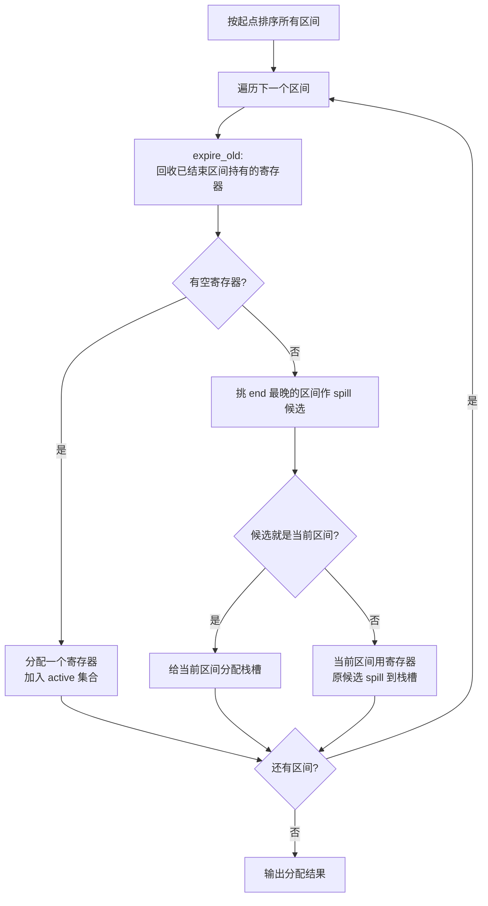

# 线性扫描寄存器分配（Linear Scan）

线性扫描（Linear Scan）由 Poletto 与 Sarkar 在 1999 年系统化提出，
复杂度近线性、实现简单，适合 LLVM 这类 AOT 编译器的快速分配和 JIT 场景。
核心思想：按起点排序活跃区间，单次扫描把过期区间让出的寄存器分配给新区间。

## 一、伪代码

**算法 · 线性扫描寄存器分配（Linear Scan Allocation）**

**输入（Input）：** 汇编代码与全部活跃区间、可用物理寄存器。
**输出（Output）：** 每个区间分配到的物理寄存器或栈槽。

```
 1: linearScan(assembly):
 2:     intervals = sortByStart(buildLiveIntervals(assembly));
 3:     active = [];                                     // 当前活跃区间，按 end 升序
 4:     free_registers = allAllocatableRegisters();
 5:     for each interval in intervals do
 6:         expireOldIntervals(active, interval.start);  // 回收已结束区间让出的寄存器
 7:         if not free_registers.empty() then
 8:             reg = free_registers.pop();
 9:             assign(interval, reg);
10:             insertSortedByEnd(active, interval);
11:         else
12:             spill = intervalWithLatestEnd(active ∪ { interval });   // 挑 end 最晚者
13:             if spill == interval then
14:                 assignStackSlot(interval);             // 当前区间自己 spill
15:             else
16:                 assignRegister(interval, spill.reg);  // 夺走候选的寄存器
17:                 assignStackSlot(spill);
18:                 replace(active, spill, interval);
19:             end if
20:         end if
21:     end for
```

两个关键操作：

- `expire_old_intervals`：把 `active` 中 `end ≤ current.start` 的区间移除，回收它们的寄存器；
- `spill`：没有空闲寄存器时，比较所有活跃区间与当前区间的 `end`，把结束最晚的区间放到栈上，把寄存器留给较早结束的区间。



## 二、与图着色的区别

| 维度 | 线性扫描 | 图着色 |
| --- | --- | --- |
| 时间复杂度 | O(N log N)，接近线性 | NP 完全问题（K 着色），需要启发式 |
| 实现难度 | 低 | 高（简化、合并、冻结、spill 选择） |
| 寄存器使用率 | 略差（贪心决策） | 通常更优 |
| 适合场景 | JIT、短寿命程序 | AOT、追求极致性能 |
| 实现复杂度 | 几百行 | 一两千行 |

ToyC 推荐先实现线性扫描——代码量小、易调试、性能足够应付课程实验。

## 三、寄存器类型与活跃区间跨调用

```text
活跃区间 = [start, end) ∩ function_body
```

跨越函数调用的活跃区间要按调用约定处理：

```cpp
bool crosses_call(LiveRange r, const vector<Instruction>& code) {
    for (int i = r.start; i < r.end; i++) {
        if (code[i].is_call()) return true;
    }
    return false;
}
```

- 跨越调用的值可分配被调用者保存寄存器（使用帧指针时保留 `s0`）；使用了这些寄存器的当前函数仍须在序言/尾声保存和恢复调用者原来的值；
- 如果被调用者保存寄存器都被占用，就在调用前后插入 `sw/lw` 把值保存在栈上。

```asm
# 调用者保存临时寄存器 t0（跨调用仍然活跃）
addi sp, sp, -16
sd   t0, 8(sp)
call foo
ld   t0, 8(sp)
addi sp, sp, 16
```

## 四、spill 实现

spill 的值需要在定义点附近插入 `store`，在使用点之前插入 `load`：

```text
# 分配前的机器 IR；v 是虚拟寄存器，不能直接交给 GNU 汇编器
addiw v, t0, 1
mulw  t1, v, a0
```

```asm
# spill 后（%v 在栈上槽位 16(sp)）
addiw t0, t0, 1           # 立即 store 到栈
sw   t0, 16(sp)
lw   t1, 16(sp)
mulw t1, t1, a0
```

- Reload 复用：若第一次加载到后续使用之间的寄存器值和内存槽都未改变，可复用加载结果；跨调用时还需遵守调用约定。这不是 rematerialization。
- Rematerialization 是在使用点重算简单定义（例如立即数装载）；若依赖其它值，必须证明这些操作数在该使用点仍然可用。

## 五、栈槽分配

spill 的值需要栈槽：

```cpp
int stack_slot(LiveRange r) {
    if (r.size == 4) return alloc_slot(4);      // int/float
    if (r.size == 8) return alloc_slot(8);      // long/double
    return alloc_slot(round_up_16(r.size));     // 数组/结构
}
```

RISC-V ABI 要求 `sp` 保持 16 字节对齐；局部 `int` 槽可按 4 字节大小和对齐分配，保存 64 位寄存器的槽需要 8 字节。栈帧总大小向上取整到 16 字节。

## 六、伪代码到 ToyC 的映射

```cpp
class LinearScan {
    vector<LiveRange> intervals;
    vector<LiveRange*> active;       // 指向 intervals 中的原始对象，不能保存副本
    set<int> free_regs;
public:
    void allocate(Assembly& asm_code) {
        active.clear();
        free_regs = allocatable_registers(asm_code); // 扣除保留 scratch / fp 等
        prepare_call_and_fixed_register_constraints(asm_code);
        intervals = build_live_ranges(asm_code);
        sort_by_start(intervals);
        for (auto& r : intervals) {
            expire_old(r.start);
            if (!free_regs.empty()) {
                int reg = *free_regs.begin();
                free_regs.erase(reg);
                r.reg = reg;
                insert_sorted_by_end(active, &r);
            } else {
                auto spill = pick_spill(active, r);
                if (spill == &r) {
                    r.spill_slot = alloc_slot(r);
                } else {
                    r.reg = spill->reg;
                    spill->spill_slot = alloc_slot(*spill);
                    erase(active, spill);
                    spill->reg = NO_REGISTER;
                    insert_sorted_by_end(active, &r);
                }
            }
        }
        emit_spill_code(asm_code);
    }
};
```

上面是实现骨架：辅助函数需维护区间位置、空闲集合与调用约束；`expire_old` 对 `end <= start` 的区间释放寄存器。若抢占后把原区间整体改为栈位置，应为它此前的所有定义和使用重新发射 spill/reload，而不是只在抢占点之后插入访存。

## 七、测试

```bash
# 执行位置：WSL / Ubuntu 开发主机终端（编译器项目根目录）
./compiler -asm        < input.c > input.s       # 不优化
./compiler -asm -opt   < input.c > input.opt.s   # 含寄存器分配
diff input.s input.opt.s                               # 观察寄存器替换与 spill

# 统计寄存器使用
grep -c "lw\|sw" input.s
grep -c "lw\|sw" input.opt.s
```

如果 `input.opt.s` 的 `lw/sw` 数显著多于 `input.s`，说明 spill 偏多，可能要换更优的活跃区间构建策略，或者减少活跃区间数量（缩短跨调用活跃）。

下一步阅读：[图着色寄存器分配](asm-graph-coloring) 或 [Spill / Reload](asm-spill)。
