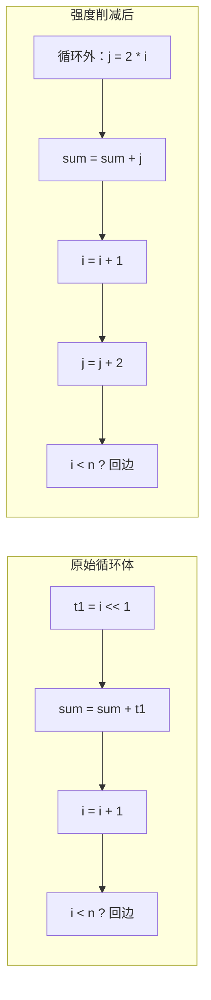

# 强度削减（Strength Reduction）

强度削减用代价更低的等价指令替换代价较高的指令。它的收益主要体现在循环体内：循环体的开销随迭代次数线性放大，每条指令都值得省。

目标代码层的强度削减只做局部、等价的指令替换；需要数学推导的变换属于机器无关优化，见 [IR 层强度削减](ir-strength-reduction)。

## 一、典型替换

后端的规则表只收集能直接验证等价的替换，其中最常见的一条是乘 2 的幂：

| 原指令 | 替换后 | 说明 |
| --- | --- | --- |
| `mulw t0, t1, t2`（`t2 = 2^k`） | `slliw t0, t1, k` | ToyC 的 32 位乘 2 的幂换成 32 位移位 |

乘数是常量且能拆成少数几个 2 的幂时同样可以拆解（例如 `x * 7` 写成 `(x << 3) - x`）；乘数是负数时先按它的绝对值替换，最后取负（`subw t0, zero, t0`）。在无额外溢出标志的 i32 IR 和机器 W 指令层，二者的低 32 位一致，移位量须满足 `0≤k<32`。源语言有符号溢出没有规定的正常结果，不能据此把对负数的移位直接写成 C 源码替换。

除法不能照搬这个思路。`divw` 是向零截断的有符号除法，`srli`（逻辑右移）与 `srai`（向下取整的算术右移）在负数上都不等于 `div`，`rem` 也没有等价的单条指令。除数是编译期常量时，改由 [强度削减（魔数法）](ir-strength-reduction) 把 `div` / `rem` 换成"乘魔数 + 移位"，后端不做这类替换。

## 二、常量传播是前置条件

强度削减要求乘数在编译期已知，因此依赖中端的常量传播：

```llvm
%t = mul i32 %i, 4        ; 乘数已知：后端可以换成 slliw
%u = mul i32 %i, %k       ; 乘数未知：只能保留乘法
```

[常量传播](ir-cprop) 传播得越充分，后端能替换掉的乘法越多。

## 三、循环中的派生归纳变量

循环里每轮都要执行一次的乘法是主要目标。以 `sum = sum + i * 2` 为例（ToyC 没有 `for`，这里用 `while` 书写）：

```c
int main() {
    int n = getint();
    int sum = 0;
    int i = 0;
    while (i < n) {
        sum = sum + i * 2;
        i = i + 1;
    }
    putint(sum);
    return 0;
}
```

`i` 是基本归纳变量（每轮加常量 1），`i * 2` 是派生归纳变量，它的变化规律同样已知（每轮加 2）。既然规律已知，就不必每轮重新计算乘法，可以在进入循环前算出 `j = i * 2`，循环内只做 `j = j + 2`：



本例把每轮一条 `slliw` 换成一条 `addiw`，并新增活跃变量；指令数并未自动减少，收益需要测量。循环展开会进一步放大这类收益：把两轮迭代合到一轮后，每轮只需给 `j` 加 4，乘法在循环体中的比例更低。

## 四、归纳变量检测

**算法 · 归纳变量检测（Detect Induction Variables）**

**输入（Input）：** 自然循环 `L`（IR 层或汇编层都可以做）。
**输出（Output）：** 基本归纳变量与派生归纳变量列表。

```
 1: detectIndVars(L):
 2:     result = [];
 3:     for each value v defined at the loop header do  // SSA 形式下通常是 phi
 4:         // 基本归纳变量：一次定义来自循环外的常量 init，另一次是 "v + 常量 c"
 5:         if hasLoopInvariantInit(v, init) and isAddWithConstant(loopDef(v), c) then
 6:             result.push( IndVar(base = v, step = c, initial = init) );
 7:         end if
 8:     end for
 9:     for each instruction I in L.instructions do
10:         // 派生归纳变量：i * k、i + c、i - c
11:         if isMulWithConstant(I, iv, k) then
12:             result.push( IndVar(base = iv, derived = I, step = iv.step * k) );
13:         end if
14:     end for
15:     return result;
```

## 五、与寄存器分配的先后关系

强度削减会引入派生归纳变量，从而产生新的活跃区间，因此必须在寄存器分配之前完成：

```text
推荐顺序：
1. 常量传播、循环不变代码外提
2. 归纳变量分析
3. 强度削减（把乘常量换成移位与加法，并引入派生归纳变量）
4. 第一轮窥孔优化（虚拟寄存器上的算术化简与复制传播）
5. 重算活跃信息，进行寄存器分配与 spill/reload 处理
6. 第二轮窥孔优化（主要清理分配产生或暴露的冗余 move）
```

若放在寄存器分配之后进行，新引入的活跃区间会破坏已经确定的寄存器映射。

## 六、正确性陷阱

| 陷阱 | 处理 |
| --- | --- |
| 负数除法与取余 | `div` / `rem` 向零截断，不能换成移位；只有能证明被除数非负时才有 `x / 2^k ≡ x >> k`，除常量统一交给 IR 层的魔数法 |
| 补码回绕 | `int` 是 32 位有符号；应使用 `mulw` / `slliw` 保持低 32 位，换成 `mulh` / `mulhu` 会得到高位而改变语义 |
| 乘数不是常量 | 运行期才能确定的乘数无法拆成移位，不要匹配这类指令 |
| 位宽 | 目标平台是 RV64，但 `int` 是 32 位，乘移位要用 32 位语义（`mulw` / `slliw`，变量移位时用 `sllw`） |
| 常量拆解过长 | `c` 的 2 的幂分解项数多于直接乘法时不再划算，规则中应设一个上限 |
| 指令延迟 | ISA 不规定周期数；依据目标处理器或评测环境实测延迟，不能断言移位一定快于乘法 |
| 活跃区间变化 | 新增派生归纳变量会改变活跃区间，必须重新分配寄存器 |
| 额外的归纳更新 | 退出前最后一次 j 更新也可能溢出；新增 IR 运算不得盲目带 nsw/nuw，或需证明额外更新的范围 |

## 七、测试

```bash
# 执行位置：WSL / Ubuntu 开发主机终端（编译器项目根目录）
# qemu-riscv64 命令也在此终端输入，由 QEMU 执行 RISC-V 程序
# 生成带循环的 ToyC 输入（注意 ToyC 没有 for，用 while）
cat > loop.c <<EOF
int main() {
    int n = getint();
    int sum = 0;
    int i = 0;
    while (i < n) {
        sum = sum + i * 2;
        i = i + 1;
    }
    putint(sum);
    return 0;
}
EOF

# 对比无优化 vs 有强度削减的汇编，并检查是否还有残留的乘/除
./compiler -asm        < loop.c > loop.s
./compiler -asm -opt   < loop.c > loop.opt.s
diff loop.s loop.opt.s
grep -nE '\b(mul|mulw|div|divw|rem|remw)\b' loop.opt.s

# 链接并运行（qemu-user 快速验证）
riscv64-unknown-elf-gcc -march=rv64gc -mabi=lp64d \
  -nostdlib -static loop.s     third_party/toyc/libtoyc.a -o loop
riscv64-unknown-elf-gcc -march=rv64gc -mabi=lp64d \
  -nostdlib -static loop.opt.s third_party/toyc/libtoyc.a -o loop.opt

# 在开发主机终端调用 qemu-user；同一组输入的输出必须完全一致
echo 10000 | qemu-riscv64 ./loop     > loop_result.out
echo 10000 | qemu-riscv64 ./loop.opt > loop_result_opt.out
diff loop_result.out loop_result_opt.out
```

完整虚拟机是另一种运行方式，需要事先准备 Ubuntu RISC-V 镜像。若选择此方式，在开发主机启动 QEMU：

```bash
# 执行位置：WSL / Ubuntu 开发主机终端 A
# 在镜像所在目录启动；镜像文件名和 U-Boot 路径按实际安装位置调整
# 保持此终端运行 QEMU，SSH 登录在另一个开发主机终端进行
# 此处磁盘已转换为 raw 格式，且已配置登录账号与 SSH
qemu-system-riscv64 \
  -machine virt \
  -cpu rv64 \
  -nographic -m 4G -smp 4 \
  -kernel /usr/lib/u-boot/qemu-riscv64_smode/uboot.elf \
  -device virtio-net-device,netdev=eth0 \
  -netdev user,id=eth0,hostfwd=tcp:127.0.0.1:2222-:22 \
  -device virtio-rng-pci \
  -drive file=ubuntu-24.04-riscv64.img,format=raw,if=virtio
```

后续文件传输、SSH 登录与虚拟机内运行步骤见 [ToyC 运行时库](../reference/toyc-runtime#编译与运行)。运行 `loop` 和 `loop.opt` 时，将上面生成的这两个可执行文件复制到虚拟机，在虚拟机终端中使用同一组输入直接执行并比较输出。

```bash
# 执行位置：WSL / Ubuntu 开发主机终端 B（编译器项目根目录）
# 等待虚拟机启动且 SSH 服务可用；账号与密码以镜像配置为准
scp -P 2222 loop loop.opt ubuntu@localhost:~/
# 此命令在开发主机输入；登录成功后，当前终端进入 QEMU 虚拟机
ssh -p 2222 ubuntu@localhost
```

```bash
# 执行位置：QEMU 虚拟机内的 RISC-V Ubuntu 终端（SSH 登录后）
cd ~
# 在虚拟机内直接执行 RISC-V 产物，并比较相同输入的输出
echo 10000 | ./loop > loop_result.out
echo 10000 | ./loop.opt > loop_result_opt.out
diff loop_result.out loop_result_opt.out
# 结束 SSH 会话，返回开发主机终端 B
exit
```

:::tip[每条规则都要有正例和反例]
强度削减的规则存在"看似等价、实则不等价"的风险。建议为每条规则准备三类测试：正例（确实应当被替换）、反例（负数、`INT_MIN` 等边界不应被替换）、回归用例（替换前后程序输出完全一致）。
:::

回到：[目标代码优化总览](../labs/part6-target-optimization)。
