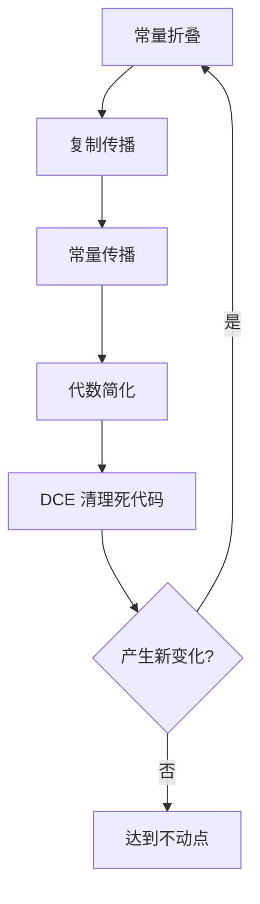

# 常量折叠、常量传播与复制传播

这是三个紧密相关的纯局部 / 半全局优化，常作为优化管线最前面的一档：
能立刻把 `%t0 = add i32 2, 3` 折叠成常量，并把已知常量沿 Use-Def 链替换到下游。

## 一、常量折叠（Constant Folding）

在编译期直接计算所有操作数都是常量或符号常量的指令：

| 模式 | 折叠结果 |
| --- | --- |
| `add i32 2, 3` | `i32 5` |
| `mul i32 4, 5` | `i32 20` |
| `icmp sgt i32 5, 3` | `i1 true` |
| `sub i32 7, 7` | `i32 0` |

实现时为每条指令尝试求值：操作数都是常量时直接算结果，否则保持原样。

```text
tryFold(I):
    if I has no result or not allOperandsConstant(I): return none;
    if I.opcode == phi: return sameConstantOnAllIncomingEdges(I);
    if I.opcode not in supportedFoldOpcodes: return none;
    return evaluateTargetWidth(I.opcode, I.type, I.flags, I.operands);
    // evaluateTargetWidth 返回 Constant 或 none，不能调用未知函数或读取内存
```

常量折叠必须使用目标位宽的整数运算，不能直接在 C++ 的有符号 `int` 上计算可能溢出的 `lhs + rhs`。还须处理除零、`INT_MIN / -1` 和 LLVM 的 `nsw` / `nuw` 标志；带溢出结果的 intrinsic 不能按普通加法折叠。初版遇到无法证明安全的情况应保留原指令。

## 二、常量传播（Constant Propagation）

沿 Use-Def 链追踪每个 SSA 值的"已知常量"。形式上：

```text
const[v] = c
若 const[a]=c、const[b]=d，且 v=f(a,b) 可按目标语义求值，则 const[v]=eval(f,c,d)
```

构造常量表的过程：

**算法 · 常量传播（Constant Propagation）**

**输入（Input）：** 函数 IR。
**输出（Output）：** 改写后的 IR 与 changed 标志；const 表是分析过程的内部结果。

```
 1: propagateConstants(func):
 2:     const = Map<Value, Constant>();
 3:     for each I in func do
 4:         if I is a constant literal then const[I.result] = I.value; end if   // 初始化
 5:     end for
 6:     repeat
 7:         changed = false;
 8:         for each I in func do
 9:             if I has a result and I.result ∉ const and allValueOperandsIn(I, const) and isSupportedFoldOpcode(I) then
10:                 value = tryEvaluateWithKnownConstants(I, const);            // 失败返回 none
11:                 if value != none then const[I.result] = value; changed = true; end if
12:             end if
13:         end for
14:     until not changed
15:     changedIR = false;
16:     for each non-literal value v in const do
17:         if hasUses(v) then replaceAllUsesWith(v, const[v]); changedIR = true; end if
18:     end for
19:     return changedIR; // 仅当实际改写 use 时为 true；常量表可另行返回
```

例如：

```llvm
%x = add i32 2, 3        ; const[%x] = 5
%y = mul i32 %x, 4       ; 操作数都是常量 → const[%y] = 20
ret i32 %y               ; 用 %y 的常量值替换 → ret i32 20
```

替换下游 use 时要小心 phi 节点：phi 的常量值必须来自所有入边都是相同常量，否则不能传播。

## 三、复制传播（Copy Propagation）

自定义 IR 中的复制形如 `x = y`，LLVM IR 中可见等价形式 `%t = add i32 %y, 0`。LLVM 的 `bitcast` 必须写明源类型，例如 `%t = bitcast i32 %y to i32`；不能省略 `i32`。
把 `x` 替换为 `y` 通常能让 `y` 直接被后续优化看到：

```llvm
%a = add i32 %x, 0      ; %a == %x
%b = mul i32 %a, 2       ; 替换为 mul %x, 2
%c = mul i32 %a, 3       ; 替换为 mul %x, 3
```

合并后：

```llvm
%x = ...
%t1 = mul i32 %x, 2
%t2 = mul i32 %x, 3
```

这里两次 `mul` 的乘数不同，不能通过 CSE 合并；复制传播只是移除了中间副本。只有操作码、类型、语义标志和全部操作数一致的纯计算才是直接的 CSE 候选。

## 四、代数恒等式

折叠/传播之外，还有一类代数简化（Algebraic Simplification），把已知模式替换为更简单的形式：

| 模式 | 化简 |
| --- | --- |
| `x + 0`, `0 + x` | `x` |
| `x - 0`, `x * 1`, `x / 1` | `x` |
| `x * 0` | `0`（ToyC 只支持整数） |
| `x - x` | `0` |
| `x ^ x` | `0` |
| `x & 0` | `0` |
| `x \| -1` | `-1`（全 1） |
| `x == x` | `true`（非 NaN 类型） |
| `x != x` | `false` |

这套规则对整数和浮点语义略有差异（比如 IEEE 754 下 `x - x = NaN`，要谨慎处理），
ToyC 只支持整数，仍须区分源语言与 IR 的位宽、溢出标志以及 `undef` / `poison` 语义。消除某个值的使用不能顺带删除为求值该操作数而执行的 I/O 或其它副作用。

## 五、迭代执行顺序

**算法 · 优化管线迭代到不动点（Optimization Pipeline）**

**输入（Input）：** 函数 IR。
**输出（Output）：** 优化后的 IR。

```
 1: runPipeline(func):
 2:     repeat
 3:         changed = false;
 4:         changed |= foldConstants(func);          // 1. 局部常量折叠
 5:         changed |= propagateCopies(func);        // 2. 复制传播
 6:         changed |= propagateConstants(func);     // 3. 常量传播（依赖 1、2 的成果）
 7:         changed |= simplifyAlgebraic(func);      // 4. 代数恒等式化简
 8:         changed |= eliminateDeadCode(func);      // 5. 清理死代码
 9:     until not changed
10:     return func;
```

几个观察：

- 折叠 → 传播：折叠后才能产生新的常量定义，传播才能进一步替换；
- 传播 → DCE：传播后旧定义失去 use，交给 DCE 删除；
- 这套循环通常只需 2~3 轮就达到不动点。



## 六、正确性陷阱

| 陷阱 | 解释 |
| --- | --- |
| 整数溢出 / 除零 | 源语言有符号溢出、除零及 `INT_MIN / -1` 不是正常结果；IR 折叠要按位宽和标志处理 |
| 函数调用操作数 | 调用 `f(const)` 不能折叠——可能改变函数行为（如 `f` 读全局） |
| `phi` 节点 | 必须所有入边常量一致才能传播 |

下一步阅读：[公共子表达式消除（CSE）](ir-cse)。
