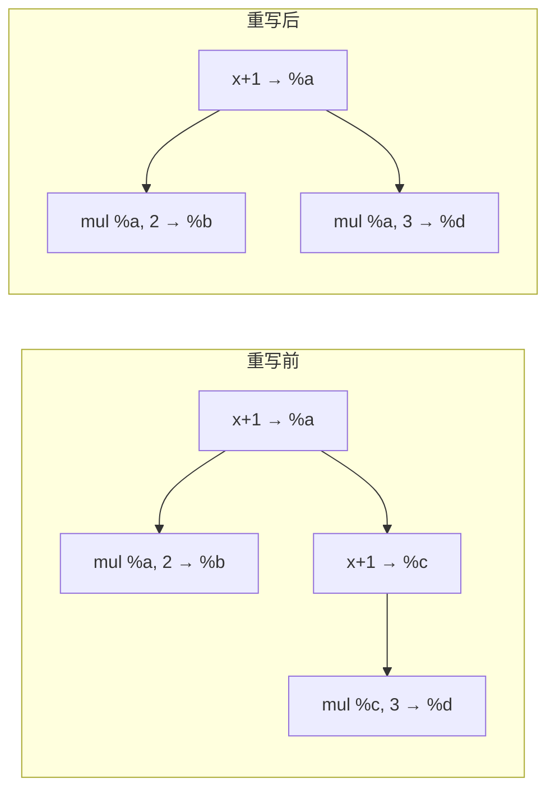
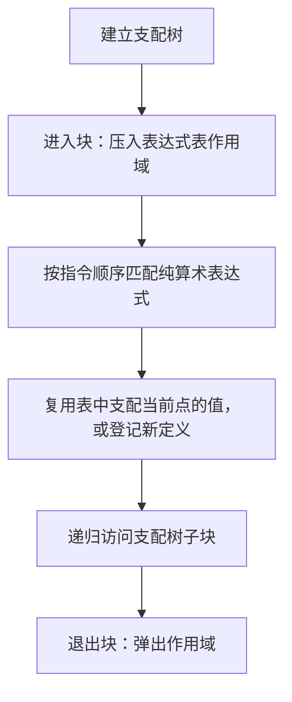

# 公共子表达式消除（Common Subexpression Elimination, CSE）

如果同一表达式在支配路径上被求值多次，且操作数没有改变，
那么第二次及以后的求值可以直接复用第一次的结果。

## 一、基本思想

```llvm
%a = add i32 %x, 1
%b = mul i32 %a, 2
%c = add i32 %x, 1      ; 与 %a 完全相同 → CSE 候选
%d = mul i32 %c, 3      ; 改写为 mul %a, 3
```

改写后：

```llvm
%a = add i32 %x, 1
%b = mul i32 %a, 2
%d = mul i32 %a, 3      ; 复用 %a，跳过 %c
```

`%c` 这条指令彻底删除，下游对 `%c` 的引用替换为 `%a`。



## 二、形式化条件

CSE 的两个条件：

1. 操作数可用性：沿当前路径从入口到当前点，每个操作数都未在两条求值之间被重定义；
2. 表达式等价：两条纯算术指令的 opcode、结果类型、操作数以及影响语义的标志都相同。内存读取还需要别名与内存状态分析，不能仅比较文本。

这等价于"表达式在支配路径上"且"两次求值之间操作数未被 kill"。

```text
available_in[B]  = ∩ available_out[P] for P in predecessors[B]
available_out[B] = gen[B] ∪ (available_in[B] − kill[B])
```

## 三、基于可用表达式分析的 CSE

类似活跃变量分析，可用表达式（Available Expressions Analysis）也是
一个前向数据流问题：

```text
AE_gen[B]  = { 块 B 内求值且在到达块出口前未被 kill 的表达式 }
AE_kill[B] = { expr(I') : I' 是块 B 中对操作数有重定义的指令 }
AE_in[B]   = ∩ AE_out[P]                      for all P in predecessors[B]
AE_out[B]  = AE_gen[B] ∪ (AE_in[B] − AE_kill[B])
```

不动点算法：

**算法 · 基于可用表达式的 CSE（Available-Expressions CSE）**

**输入（Input）：** 函数 CFG。
**输出（Output）：** 消除重复表达式后的 IR。

```
 1: cse(func):
 2:     DT = computeDominatorTree(func);
 3:     visit(func.entry, emptyScopedMap(), DT);
 4:
 5: visit(B, table, DT):
 6:     table.pushScope();                               // 每个支配树分支独立
 7:     for each instruction I in B in program order do
 8:         if not isPureArithmeticOrComparison(I) then continue; end if
 9:         key = (I.opcode, I.type, I.flags, I.operands);
10:         if table contains key then
11:             V = table[key];                          // 同块前面的定义或支配块中的定义
12:             replaceAllUsesWith(I.result, V); eraseSafely(I);
13:         else table[key] = I.result; end if
14:     end for
15:     for each child C of B in DT do visit(C, table, DT); end for
16:     table.popScope();                                // 防止兄弟分支互相复用非支配定义
```

可用表达式分析只证明每条到达路径都计算过这个表达式，不保证存在一个支配当前点的 SSA 定义。例如菱形 CFG 的两个分支各自计算 `%x + 1`，汇合块不能任意复用某一分支的值；需要新建 `phi`，或保守保留该计算。上面的支配树算法只复用确定支配使用点的定义，避免这个错误。其设计可对照 [LLVM EarlyCSE 说明](https://llvm.org/docs/Passes.html#early-cse-early-common-subexpression-elimination)。



## 四、局部 CSE 与全局 CSE

| 类型 | 范围 | 实现 |
| --- | --- | --- |
| 局部 CSE | 单个基本块内 | 在块内维护 `unordered_map<Expr, Value*>` |
| 全局 CSE | 整个函数 | 依赖可用表达式分析 + 支配树 |

第一版可先实现局部 CSE，再按上面的支配树作用域扩展到全局。仅有表达式集合还不足以确定安全的 SSA 替换值。

## 五、与 GVN 的关系

更激进的版本叫 GVN（Global Value Numbering）：

- CSE 只识别字面相同的表达式；
- GVN 为等价值建立值编号（VN）；哈希可用于查表，但发生碰撞时仍须比较结构，等价的表达式即使字面不同也能合并：

  ```llvm
  %a = add i32 %x, %y
  %b = add i32 %y, %x     ; 字面不同但交换律下等价
  ```

- GVN 还会跟踪 `phi` 节点上的等价性，是更通用的 CSE。

完成 CSE 后，可进一步实现 GVN，识别跨基本块的等价表达式。

## 六、与其它优化的关系

- CSE 之前：建议先做常量折叠/传播——把 `%a = add i32 2, 3` 折叠后下游字面相同，便于匹配；
- CSE 之后：替换 use 后旧定义可能失去 use，交给 DCE 清理；
- CSE 可消除支配路径上的重复计算；把循环不变指令移到预头仍需要 LICM 的不变性和安全性检查。

## 七、实现注意事项

| 问题 | 处理 |
| --- | --- |
| `load` 指令 | ToyC 的内存访问型 IR 使用 load；第一版 CSE 保守跳过，进一步优化须证明内存内容未改变 |
| 函数调用 | 未知调用可能改变内存；不能跨它复用未经分析的 load。纯算术 SSA 表达式不因此自动失效 |
| `phi` 节点 | phi 是合并点，不参与 CSE 的"等价表达式"集合 |
| 浮点 | 不得因浮点结合律重排就宣称等价；严格 CSE 也须匹配类型、全部操作数和语义属性 |

下一步阅读：[控制流简化](ir-cfg-simplify)。
