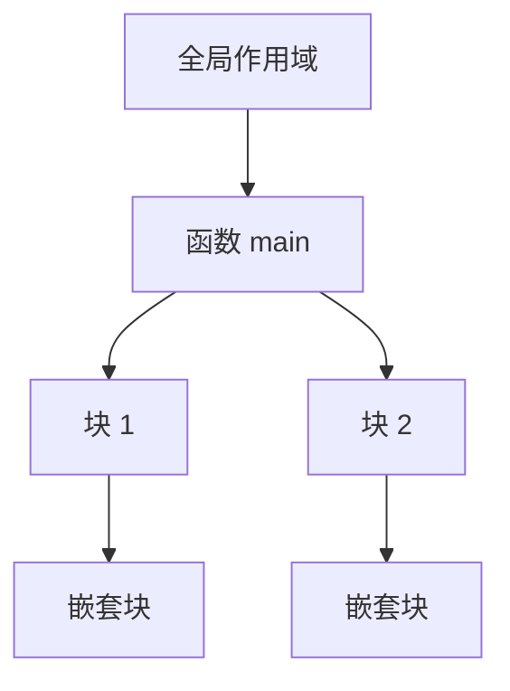

# 常见问题 FAQ

## 通用

### Q：可以用语言自带的库做词法分析吗？

可以，但必须能解释清楚它内部做了什么。实验报告需要补充说明该库所采用的
自动机模型与等价的手工实现方案。

### Q：测试用例的输出格式必须逐字符一致吗？

行号、列号、字面量必须一致；空白与制表符的差异不计入错误。建议用
`diff -w` 做本地比对。

### Q：编译器崩溃算不算"错误输入处理失败"？

算。任何输入（包括非法输入）都不允许让程序异常终止。请为每个阶段设置
错误恢复路径。

## 第一部分 · 词法分析

### Q：`a+++++b` 该怎么切分？

按最长匹配，但要先注意 ToyC 的运算符表里没有 `++`，`+` 只能单个出现，
因此切分为 `a` `+` `+` `+` `+` `+` `b`（7 个 Token）。按 ToyC 文法，
第一个 `+` 是加法，后面四个是作用于 `b` 的一元正号，所以它在语法上是合法的。
词法阶段只负责切分 Token，运算结构由语法分析处理。

### Q：块注释未闭合怎么办？

报告错误 `unterminated comment` 并给出起始行号，然后终止词法分析
（或跳到文件末尾后终止）。

## 第二部分 · 语法分析

### Q：递归下降遇到左递归就死循环？

直接照着 `AddExpr -> AddExpr ('+' | '-') MulExpr | MulExpr` 调用自身，
就会在读入 Token 之前不断递归。递归下降可以先读一个 `MulExpr`，再循环处理
后面的加减运算；预测分析表则可引入一个尾部符号：

```text
AddExpr     -> MulExpr AddExprTail
AddExprTail -> '+' MulExpr AddExprTail | '-' MulExpr AddExprTail | ε
```

`AddExprTail` 是构造预测分析表时使用的辅助符号。无论采用循环还是尾部规则，
AST 都要保留 ToyC 文法规定的左结合性，例如 `a - b - c` 应组织成 `(a - b) - c`。

### Q：LL(1) 预测分析表有冲突怎么办？

同一表项需要填入两条不同产生式时，当前规则不能直接用于 LL(1) 分析。
先检查左递归和共同前缀，按[语法分析实验](../labs/part2-parser.md)中的方法处理。
`else` 要遵守文法页规定的归属规则。也可以在第二部分选择 LR 分析路线。

报告中必须说明冲突出现在哪两个产生式之间。

### Q：SLR(1) 有移进-归约冲突？

先确认冲突状态中的项目，以及冲突出现在哪个 Token 列。FOLLOW 集过于宽泛时，
LR(1) 或 LALR(1) 可以提供更具体的向前看信息；文法歧义则还需要消歧规则。
例如 `else` 要匹配最近的未匹配 `if`，换一种分析表算法并不会自动消除这个歧义。

## 选做的语义分析

### Q：符号表作用域怎么组织？

推荐使用作用域栈 + 每层哈希表：



查找时自内向外逐层搜索，退出块时弹出对应表。

### Q：变量未声明就使用，应该在哪个阶段报错？

语义分析阶段。词法与语法阶段不应涉及符号信息。

## 第三部分 · 中间代码生成

### Q：为什么需要临时变量？

为了把复合表达式拆成"一个四元式只做一次运算"，便于后续优化和指令选择。

### Q：布尔表达式的短路求值怎么写？

用回填（backpatching）技术：先生成跳转指令占位，待目标确定后再填写标号。
参见[第三部分](../labs/part3-ir)中的回填示例。

## 第五部分 · 中间代码优化

### Q：优化越多越好吗？

不是。优化必须在保持语义等价的前提下进行，且要考虑编译时间成本。
报告中需给出优化前后的指令数对比。

### Q：如何验证优化没有改变语义？

对同一组测试用例，比较优化前后程序的运行结果是否完全一致。

## 第四部分 · 目标代码生成

### Q：寄存器不够用怎么办？

使用图着色或线性扫描做寄存器分配，溢出部分写入栈帧。
报告中需说明所选算法与溢出处理策略。

### Q：生成的汇编在本机跑不了？

请确认使用的是统一规定的 RISC-V64GC 工具链，并指定 `-march=rv64gc` 与
`-mabi=lp64d`。最终链接时还要加入 ToyC 运行时静态库 `libtoyc.a`，
否则 `getint` 或 `putint` 等外部符号会解析失败。

## 环境与提交

### Q：助教的一条命令构建失败了？

通常是缺少构建脚本或硬编码了绝对路径。请在干净环境中用
`git clone` 后重新验证一次，确保没有遗漏文件。

### Q：PR 被合并后还能改吗？

可以，用新的 commit 推送到同一分支，PR 会自动更新。
