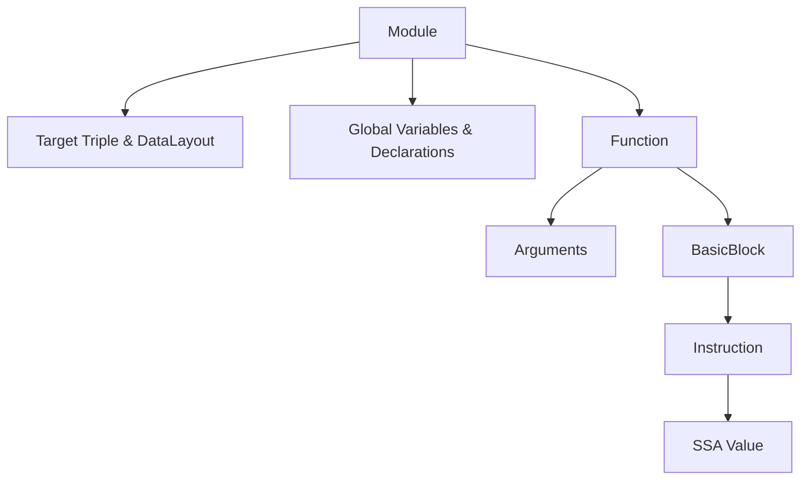
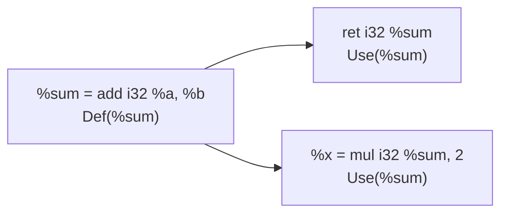
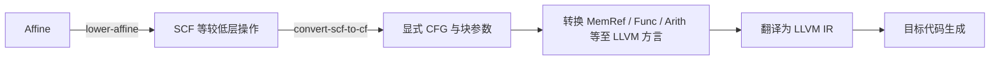

# LLVM IR 与 MLIR 参考

:::caution[工程约束]
课程编译器不能直接套用 Clang、LLVM、MLIR 的分析、优化或代码生成实现。LLVM IR 与 MLIR 仅作为参考架构，用于理解 SSA 设计、`phi` 语义、多阶段 lowering 等思想。词法与语法分析阶段允许使用工具生成代码骨架（例如基于 Flex/Bison 的实现），但 IR 生成、优化、目标代码生成都必须自行完成。可选择自定义三地址码或自行维护的 LLVM 风格文本 IR；生成器所需的前端运行库与课程提供的目标运行时按相应接口使用。
:::

第三部分的 IR 设计建议使用自定义三地址码，必要时可参考 LLVM IR 与 MLIR 的设计理念。本页用于在开始第三部分前建立共同概念。

## 一、LLVM IR 的结构

LLVM IR 是一种强类型 SSA 三地址码：每条指令最多一个算术结果，可以有 0 个或多个操作数；它同时是编译器内部表示和文本格式（`.ll`），用 `llvm-as` / `llvm-dis` 可以双向转换。

:::info
LLVM IR 仅作为 ToyC IR 设计的参考架构，课程项目禁止集成 LLVM 库。同学们应参考 LLVM IR 的 SSA 组织形式、`phi` 节点语义、内存模型（alloca/load/store）和 calling convention，自行决定三地址码的结构。
:::

### 1.1 层级结构



- **Module**：一个编译单元，相当于一个 `.c` 文件翻译后的产物；包含目标三元组（`riscv64-unknown-elf`）、数据布局（指针宽度、对齐）、全局变量、外部函数声明、若干 Function。
- **Function**：包含参数列表、返回类型、若干 BasicBlock；可以带属性（如 `readonly`、`nounwind`）帮助优化器推断副作用。
- **BasicBlock**：以标签（如 `entry:`、`while.body:`、`while.end:`）开头，单入口、末尾一个终结指令（该指令可有多个后继），最后一条指令必须是 terminator（`br` / `switch` / `ret` / `unreachable`）。
- **Instruction**：基本计算单元，结果用 `%name` 表示。
- **SSA Value**：每个 SSA 名称在函数内只被定义一次；控制流汇合处用 `phi` 选择来自不同前驱的值。

### 1.2 SSA 形式

SSA（Static Single Assignment，静态单赋值）是一种 IR 组织形式：每个 SSA 名称在一个函数中只能被定义一次，但可以被多次使用。这里的"单次赋值"针对编译器内部的值，不是说源程序变量只能赋值一次。

例如 ToyC：

```c
x = a + 1;
x = x * 2;
```

在普通变量表示中，两次赋值都写入 `x`；在 SSA 中，每次赋值产生新版本：

```llvm
%x1 = add i32 %a, 1
%x2 = mul i32 %x1, 2
```

这样每个名称的定义位置唯一，Use-Def / Def-Use 链是显式的，可以直接从一个值找到它的所有使用点，或从一条指令找到它的所有定义点。

### 1.3 控制流汇合与 phi

如果同一个源变量在不同控制流路径被赋予不同值，单纯改名无法决定汇合处使用哪个版本。`phi` 根据"从哪条前驱边进入"选择值：

```c
if (cond) x = 1;
else      x = 2;
return x;
```

对应的 LLVM IR 结构是：

```llvm
br i1 %cond, label %then, label %else
then:
  br label %join
else:
  br label %join
join:
  %x = phi i32 [ 1, %then ], [ 2, %else ]
  ret i32 %x
```

`phi` 的参数成对出现：`[值, 前驱块]`。优化器可以遍历 `phi` 的 operand，快速构建数据流图。

### 1.4 常用指令族

| 类别 | 关键指令 | 说明 |
|---|---|---|
| 算术 | `add / sub / mul / sdiv / srem` | 整数运算；`fadd / fmul` 等浮点 |
| 比较 | `icmp slt / sgt / eq` | 整数比较；`fcmp` 浮点 |
| 内存 | `alloca / load / store / getelementptr` | `alloca` 在栈上分配；`getelementptr`（GEP）只算地址，不访问内存 |
| 调用 | `call / invoke` | 调用约定由参数类型与属性决定 |
| 终止符 | `br / switch / ret / unreachable` | 必须放在 BasicBlock 末尾 |
| SSA 汇合 | `phi` | 选前驱块传入的值 |
| 类型转换 | `trunc / zext / sext / bitcast / ptrtoint / inttoptr` | 影响后续优化合法性 |
| 选择 | `select i1 %c, i32 %a, i32 %b` | 等价于无分支的三目运算符 |

### 1.5 类型系统

LLVM IR 的类型影响 lowering 和优化合法性：

| 类型 | 例子 | 含义 |
|---|---|---|
| 整数 | `i1 / i32 / i64` | 任意宽度整数，`i1` 是布尔 |
| 浮点 | `float / double` | IEEE 754 binary32 / binary64 |
| 指针 | `ptr`（新版）/ `i8*` / `i32*` | 本页使用 LLVM 18 的 opaque pointer `ptr`；元素类型写在 load/store/GEP 中 |
| 数组 | `[10 x i32]` | 定长数组，元素布局确定 |
| 结构 | `{ i32, float }` | 字面顺序的字段集合 |
| 函数 | `i32 (i32, i32)` | 函数类型；opaque pointer 模式下函数指针值使用 ptr |

例如，`getelementptr [10 x i32], ptr %arr, i64 0, i64 %i` 计算 `&arr[i]`，不读取内存；后续 `load i32, ptr %p` 才读取该地址的值。IR 将地址计算与内存访问分开表示，便于分别分析指针运算和读写操作。

### 1.6 内存模型与 SSA 提升

LLVM IR 用 `alloca` 模拟"局部变量在栈上的位置"：

```llvm
define i32 @toy_max(i32 %a, i32 %b) {
entry:
  %x = alloca i32          ; 分配 4 字节栈空间
  %cond = icmp sgt i32 %a, %b
  br i1 %cond, label %then, label %else
then:
  store i32 %a, ptr %x
  br label %join
else:
  store i32 %b, ptr %x
  br label %join
join:
  %r = load i32, ptr %x
  ret i32 %r
}
```

这里 `alloca` + `store` + `load` 把变量 `x` 当成内存对象处理，控制流汇合时不需要 `phi`。代价是每次读 `x` 都要 `load`，每次写 `x` 都要 `store`，不利于优化。`mem2reg` pass 会：

1. 找到只被 `alloca/store/load` 使用的局部变量；
2. 在控制流汇合处插入 `phi`；
3. 删除 `store`，把 `load` 重写为 SSA 值直接使用。

优化后等价于：

```llvm
define i32 @toy_max(i32 %a, i32 %b) {
entry:
  %cond = icmp sgt i32 %a, %b
  br i1 %cond, label %then, label %else
then:
  br label %join
else:
  br label %join
join:
  %r = phi i32 [ %a, %then ], [ %b, %else ]
  ret i32 %r
}
```

实现建议：第三部分先输出 `alloca/load/store` 形式以保证正确性即可，不要求在这一步实现 mem2reg；把变量提升到 SSA 的 mem2reg 属于第五部分的机器无关优化，做法见 [mem2reg：把内存访问提升为 SSA](../optim/ir-mem2reg)。如果在第五部分也不实现，后续的常量传播、公共子表达式消除、死代码消除都只能停留在内存模型上，目标程序的访存也会明显偏多。

### 1.7 数组扩展的 C 程序示例

下面把 `int sum_abs(int *A, int n)`（求数组前 n 个元素的绝对值之和）翻译成 LLVM IR，涵盖循环、归纳变量 `phi`、内存加载、函数调用。

C 源码（包含基础 ToyC 不支持的数组、指针与条件运算符）：

```c
int abs(int x) { return x < 0 ? -x : x; }

int sum_abs(int *A, int n) {
  int s = 0;
  int i = 0;
  while (i < n) {
    s = s + abs(A[i]);
    i = i + 1;
  }
  return s;
}
```

LLVM IR（未优化）：

```llvm
define i32 @abs(i32 %x) {
entry:
  %cmp = icmp slt i32 %x, 0
  br i1 %cmp, label %neg, label %pos
neg:
  %r1 = sub i32 0, %x
  br label %end
pos:
  br label %end
end:
  %r = phi i32 [ %r1, %neg ], [ %x, %pos ]
  ret i32 %r
}

define i32 @sum_abs(ptr %A, i32 %n) {
entry:
  br label %loop.header
loop.header:                                     ; 循环条件
  %i = phi i32 [ 0, %entry ], [ %i.next, %loop.body ]
  %s = phi i32 [ 0, %entry ], [ %s.next, %loop.body ]
  %cond = icmp slt i32 %i, %n
  br i1 %cond, label %loop.body, label %loop.end
loop.body:                                       ; 循环体
  %idx = sext i32 %i to i64
  %elem.ptr = getelementptr i32, ptr %A, i64 %idx
  %elem = load i32, ptr %elem.ptr
  %val = call i32 @abs(i32 %elem)
  %s.next = add i32 %s, %val
  %i.next = add i32 %i, 1
  br label %loop.header
loop.end:
  ret i32 %s
}
```

要点：

- 归纳变量用 phi 表达：`%i` 和 `%s` 在 `loop.header` 既是循环入口定义（来自 `entry`）也是循环回边定义（来自 `loop.body`）；这是 LLVM IR 表达 `for`/`while` 循环的标准模式。
- `getelementptr` 不读内存：`%elem.ptr = getelementptr i32, ptr %A, i64 %idx` 只算地址；`load i32, ptr %elem.ptr` 才真正访问内存；中间可以插入别名分析而不影响正确性。
- `call` 遵循 calling convention：`@abs(i32 %elem)` 默认按 C 调用约定传参；返回 `i32` 放在 `a0`（RISC-V）或 `eax`（x86）。使用 LLVM 后端时由其处理；课程项目需要自行实现相应的参数传递与返回值处理。
- `sext i32 %i to i64`：GEP 允许整数类型索引；此处显式扩展到 `i64` 来匹配示例的 64 位地址运算，并不要求所有索引都必须是 `i64`。

### 1.8 LLVM IR 到 RISC-V 的端到端 lowering

把上面的 `sum_abs` 在 `opt -O2` 后交给 `llc -mtriple=riscv64-unknown-linux-gnu -mattr=+m,+a,+f,+d,+c`，用 LLVM 18 实际生成的 RV64GC 汇编片段：

```asm
sum_abs:                                # @sum_abs
# %bb.0:                                # %entry
	sext.w	a2, a1
	blez	a2, .LBB1_4
# %bb.1:                                # %loop.body.preheader
	li	a2, 0
	addi	a1, a1, -1
	slli	a1, a1, 32
	srli	a1, a1, 30
	add	a1, a1, a0
	addi	a1, a1, 4
.LBB1_2:                                # %loop.body
                                        # =>This Inner Loop Header: Depth=1
	lw	a3, 0(a0)
	sraiw	a4, a3, 31
	xor	a3, a3, a4
	subw	a4, a4, a2
	addi	a0, a0, 4
	subw	a2, a3, a4
	bne	a0, a1, .LBB1_2
# %bb.3:                                # %loop.end
	mv	a0, a2
	ret
.LBB1_4:
	li	a2, 0
	mv	a0, a2
	ret
```

实际输出中，`abs` 已内联，循环通过指针每次前进 4 字节来访问数组；基地址寄存器直到读取结束前都保留为地址。32 位绝对值和累加使用 `subw` 等指令保持 `i32` 语义，结束时才把累加结果放到 `a0`。不同 LLVM 版本可能生成不同序列，应以运行结果、ABI 和 IR verifier 为依据。该示例仅用于理解 lowering；课程编译器仍须自行实现后端。

### 1.9 LLVM IR 的优点与局限

优点

- **SSA 便于分析数据依赖**：每个值只有一个定义，可通过 Use-Def / Def-Use 链查找定义和使用位置；DCE、CSE、常量传播等优化可以据此实现。
- **显式表示 CFG**：IR 记录基本块及其前驱、后继关系，可用于循环识别、控制流简化和基本块合并。
- **算法参考资料**：可参考 LLVM、GCC 的实现和相关论文，理解死代码消除、常量传播、循环不变代码外提等算法，并自行实现。
- **中端与后端分离**：中端对 IR 进行分析和优化，后端负责指令选择、寄存器分配与汇编输出；课程项目需要自行实现这两部分。
- **适合作为 IR 设计参考**：三地址码、`phi` 节点和基本类型系统可用于自定义 IR，无需引入 MLIR 的 Dialect 层次。

局限

- 高层信息被过早丢失：`for (int i = 0; i < n; i++)` 在 lowering 后只剩 `phi + icmp + addi`；想写跨循环优化（fusion、tiling）已经无法直接从 IR 看出"这是循环"，必须重建 LoopInfo。
- 内存模型复杂：`load/store/getelementptr/atomic/ordering/volatile` 的语义细节多；初学者常误用 `volatile` 当 `atomic`，或者忘记 GEP 必须 64 位索引。
- 与 MLIR 重复建设：LLVM 15+ 已开始用 MLIR 重建部分基础设施；如果课程选了 LLVM IR，未来想升级到 MLIR 几乎要重写 IR 生成层。


## 二、Use-Def 链

Use-Def 链记录 IR 中每个值的定义位置和所有使用位置，是连接 SSA、数据流分析与优化的重要关系。

- **Def（Definition）**：产生一个值的指令或函数参数。例如 `%sum = add i32 %a, %b` 定义 `%sum`；
- **Use（Use）**：读取某个值的操作数位置。例如 `ret i32 %sum` 使用 `%sum`；
- **Use-Def 链**：从一次使用反向找到它对应的定义；
- **Def-Use 链**：从一次定义正向找到该值的全部使用。



在 SSA 形式下，普通 SSA 值只有一个定义，因此 Use-Def 链可以直接通过值的定义指针定位；多个控制流来源汇合时，由 `phi` 指令定义一个新值。内存变量经过 `alloca/load/store` 表示时，一个变量可能有多个 store 定义，需要借助内存到 SSA 的转换或到达定义分析建立对应关系。

### 建议数据结构

```text
Value {
  name
  type
  definition: Instruction | Argument
  uses: List<Use>
}

Use {
  user: Instruction
  operand_index
}

Instruction {
  operands: List<Value>
  result: Value?
}
```

创建指令时，为每个操作数向被使用的 `Value.uses` 追加一条 `Use`；删除或替换指令时，必须同步移除旧 Use 并更新新值的 Use 列表。也可以使用 `def -> uses` 和 `use -> def` 两张哈希表实现同样关系。

### Use-Def 链的作用

1. 常量传播：若 Def 是常量定义，沿所有 Use 替换为常量。
2. 死代码消除：若一条纯计算指令的结果没有任何 Use，可以删除该指令；有函数调用、存储等副作用的指令不能仅凭无 Use 删除。
3. 公共子表达式消除：检查已有计算结果是否仍然有效，并把新的 Use 重定向到旧 Def。
4. 活跃变量分析和寄存器分配：根据 Use 的位置计算值的活跃区间，确定何时释放寄存器或插入 spill。
5. 验证 IR：检查每个 Use 是否能找到合法 Def，检查 SSA 值是否违反单一定义规则。

例如：

```llvm
%t0 = add i32 %a, 1
%t1 = mul i32 %t0, 2
ret i32 %t1
```

`%t0` 的 Def 是第一条指令，Use 是第二条指令；`%t1` 的 Def 是第二条指令，Use 是 `ret`。如果 `%t1` 没有 Use，且第二条指令没有副作用，则可以执行死代码消除。

### 建立 Use-Def 链的伪代码

```text
build_use_def(function):
  for block in function.blocks:
    for instruction in block.instructions:
      if instruction.result exists:
        instruction.result.definition = instruction
      for index, operand in enumerate(instruction.operands):
        operand.uses.append(Use(instruction, index))

replace_all_uses(old_value, new_value):
  for use in copy(old_value.uses):
    use.user.operands[use.operand_index] = new_value
    new_value.uses.append(use)
  old_value.uses.clear()
```


## 三、MLIR 的结构

MLIR 用 Operation、Region、Block 和 SSA Value 组织程序，Dialect 则定义某类操作、类型和属性。一个 Region 可以包含多个基本块，块参数表达来自前驱的值；是否必须有 terminator 由所属 operation 的约束决定。

本节用数组求和说明不同层次的表示。数组和指针属于扩展语言示例，不属于基础 ToyC。示例使用 MLIR 18 的语法，可用 `mlir-opt` 进行解析和 verifier 检查；课程编译器的实现仍须自行完成。

### 3.1 Affine 方言

Affine 保留可分析的循环边界与访问关系。下标可包含维度、符号和常数构成的仿射表达式，函数参数 `%n` 可以作为动态符号，因此“运行时才知道循环上界”并不意味着不能使用 Affine。`affine.for` 的步长要求为正整数常量，数据相关的复杂控制流可能需要 SCF 或 CF。

```mlir
func.func @sum_affine(%A: memref<?xi32>, %n: index) -> i32 {
  %zero = arith.constant 0 : i32
  %sum = affine.for %i = 0 to %n iter_args(%acc = %zero) -> (i32) {
    %value = affine.load %A[%i] : memref<?xi32>
    %next = arith.addi %acc, %value : i32
    affine.yield %next : i32
  }
  return %sum : i32
}
```

仿射表达式提供分析信息，但不能自动证明所有循环变换合法；交换、融合和并行化仍须检查读写依赖、别名和副作用。分块与循环交换是不同变换，不能把 `affine-loop-tile` 的执行直接等同于任意循环顺序的交换。定义与限制见 [Affine 官方说明](https://mlir.llvm.org/docs/Dialects/Affine/)。

### 3.2 SCF 方言

SCF 表示结构化循环和分支。`scf.for` 的上下界、步长是类型一致的 SSA 整数或 index 值，步长须满足操作的合法性要求；循环携带的值由 `iter_args` 输入并由 `scf.yield` 返回。

```mlir
func.func @sum_scf(%A: memref<?xi32>, %n: index) -> i32 {
  %c0 = arith.constant 0 : index
  %c1 = arith.constant 1 : index
  %zero = arith.constant 0 : i32
  %sum = scf.for %i = %c0 to %n step %c1 iter_args(%acc = %zero) -> (i32) {
    %value = memref.load %A[%i] : memref<?xi32>
    %next = arith.addi %acc, %value : i32
    scf.yield %next : i32
  }
  return %sum : i32
}
```

循环不变代码外提仍需要副作用、别名和可推测执行性证明。动态边界不等于所有依赖分析或循环变换都失效；可实施的优化取决于可证明的访问关系。一般的 `break` / `continue` 不能直接作为 `scf.for` 的任意跳转，可使用相应的结构化改写、`scf.while` 或降低到 CF。详见 [SCF 官方说明](https://mlir.llvm.org/docs/Dialects/SCFDialect/)。

### 3.3 CF 方言

CF 用显式基本块和分支表达控制流。MLIR 的块参数对应 LLVM IR 中 `phi` 表达的边上取值；它们不是需要内存加载的地址。

```mlir
func.func @sum_cf(%A: memref<?xi32>, %n: index) -> i32 {
  %c0 = arith.constant 0 : index
  %c1 = arith.constant 1 : index
  %zero = arith.constant 0 : i32
  cf.br ^loop(%c0, %zero : index, i32)
^loop(%i: index, %acc: i32):
  %condition = arith.cmpi slt, %i, %n : index
  cf.cond_br %condition, ^body, ^exit(%acc : i32)
^body:
  %value = memref.load %A[%i] : memref<?xi32>
  %next_sum = arith.addi %acc, %value : i32
  %next_i = arith.addi %i, %c1 : index
  cf.br ^loop(%next_i, %next_sum : index, i32)
^exit(%result: i32):
  return %result : i32
}
```

这里 `%A` 保留 `memref` 类型，`memref.load` 的下标是 `index`；不能把 `index` 类型的裸地址直接当成 memref 加载。CF 只说明控制流已显式化，不意味着所有操作已经一一对应机器指令。内联和跨过程优化仍可在含函数与 CFG 的表示上执行。详见 [CF 官方说明](https://mlir.llvm.org/docs/Dialects/ControlFlowDialect/)。

### 3.4 Lowering 与选型



MLIR 提供相应转换 pass，但使用时须满足输入操作的合法性、类型转换和 pass 顺序，不能只凭方言名称推断转换已经完成。降低结构化循环时把迭代值变为块参数，随后翻译到 LLVM IR 才表达为 `phi`；SCF 到 CF 的转换不需要先从 CFG 反向识别循环。

对课程项目，可参考上述分层设计而实现自己的数据结构和转换算法。选择 LLVM 风格的文本 IR 不意味着必须链接 LLVM 库；自定义三地址码与自行维护的 LLVM 风格 IR 都需要自行实现优化、指令选择、寄存器分配和调用约定。
